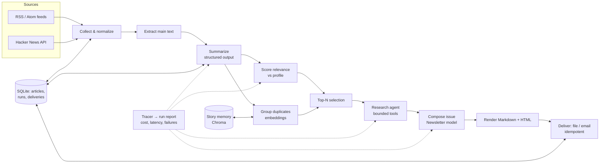

# Stage 1 — Final project: **Morning Brief**, a personalized morning-newsletter agent

## 1. Pitch

Every morning at 07:00 you receive a short, personalized brief: the eight to twelve stories that
matter to *you* from sources you chose, each with a faithful three-bullet summary, one line on why it
matters to you, links to the originals, "also covered by" when several sources ran the story, and
"follow-up to Tuesday" when you have seen it before. The top three stories get an extra paragraph of
context gathered by a small, bounded research agent. One issue costs cents, is never sent twice,
survives a dead feed or a provider outage, ignores instructions planted inside articles, and every
claim links to a source.

For interviews this is a complete, honest system: structured outputs, tool use, a bounded agent,
embeddings and a vector store (where they pay for themselves), evals with a judge, tracing and cost
accounting, retries and fallbacks, injection defenses, a scheduled deployment, tests, and a README
with an architecture diagram.

## 2. Scope

In scope: public RSS/Atom feeds and the Hacker News API; one reader (you); file and email delivery;
daily schedule; evaluation; operations. Out of scope (documented as "next" in the README):
multi-user, authentication, a web UI, paywalled sources, social-media sources, and "ask my archive"
chat (an optional extension if time remains).

## 3. Requirements

Functional

| # | Requirement |
| --- | --- |
| F1 | Collect items from a configurable list of RSS/Atom feeds and from Hacker News top stories |
| F2 | Normalize, deduplicate by canonical URL, extract the main text with limits |
| F3 | Produce a structured summary per article (schema, validated) |
| F4 | Score relevance against a reader profile (interests, avoid-list, source weights) with a reason |
| F5 | Group near-duplicate stories across sources; detect follow-ups to stories seen on earlier days |
| F6 | For the top three stories, gather extra context with a bounded tool-using agent |
| F7 | Compose the issue into sections and render Markdown and HTML |
| F8 | Deliver to a file (default) and by email; never deliver the same issue twice |
| F9 | Run every morning on a schedule without a laptop being on |
| F10 | Provide evals, per-run traces, a run report and cost per issue |

Non-functional

| # | Requirement | How it is checked |
| --- | --- | --- |
| N1 | Cost ≤ $0.25 per issue (target $0.10) | run report; budget guard stops the run |
| N2 | A run finishes in ≤ 10 minutes | run report timing |
| N3 | Partial failures tolerated: one bad feed/article/provider call never kills the run | chaos tests |
| N4 | No instruction planted in an article is obeyed; links only from fetched sources | injection eval cases; sanitizer tests |
| N5 | No secrets or employer data in the repository | secrets audit in CI |
| N6 | Tests run offline in seconds; live checks are explicit | `make test` vs. `make eval` |
| N7 | Every issue records prompt, model and index versions | issue metadata |

## 4. Architecture

### Pipeline stages

| Stage | Input → output | Model? | Shape | Module |
| --- | --- | --- | --- | --- |
| 1 Collect | feeds, HN → `Article` rows | no | workflow | `sources/` |
| 2 Extract | URL → main text (capped) | no | workflow | `extract.py` |
| 3 Summarize | text → `ArticleSummary` | Flash-Lite-class, structured output | parallel workflow | `summarize.py` |
| 4 Score | summary + profile → `Relevance` (score, reason) + rule boosts | Flash-Lite-class | parallel workflow | `rank.py` |
| 5 Group | summaries → clusters (embeddings, cosine) + follow-ups vs. memory | embeddings API | workflow | `cluster.py`, `memory.py` |
| 6 Research | top-3 stories → extra context with sources | Flash-class + tools | bounded agent | `research.py` |
| 7 Compose | structured inputs → `Newsletter` → Markdown/HTML | Flash-class | workflow | `compose.py`, `render/` |
| 8 Deliver | rendered issue → file / email, delivery record | no | workflow | `deliver/` |
| 9 Report | traces → run report (cost, latency, failures) | no | workflow | `tracing.py`, `report.py` |

Plain code where plain code wins: URL canonicalization, source weights, recency decay, link
allowlisting, sanitization, scheduling, delivery, budgets. The model is used only where language
understanding is the job: summaries, relevance with reasons, research, composition.

### Diagram



### Data model (SQLite + Chroma)

- `articles(id, url, canonical_hash, source, published_at, title, text, fetched_at, extract_status)`
- `summaries(article_id, schema_version, json, model, tokens_in, tokens_out, cost)`
- `scores(article_id, run_id, score, reason, boosts_json)`
- `clusters(run_id, cluster_id, representative_article_id, member_ids_json)`
- `issues(run_id, date, markdown, html, metadata_json)` — metadata includes prompt/model/index versions
- `runs(id, date, started_at, finished_at, status, cost, report_json)`
- `deliveries(issue_id, channel, delivered_at, idempotency_key)`
- Chroma collection `story_memory`: embedding of title + lead, metadata `{date, cluster_id, url}`, retention 60 days

### Reader profile (`profile.yaml`)

Interests with weights, avoid-list, preferred sources with weights, language preference, issue
length, delivery channel. Loaded once, cached into the prompt prefix (prompt caching).

## 5. Decisions and simpler alternatives

| Decision | Chosen | Simpler alternative | Why the choice |
| --- | --- | --- | --- |
| Classic RAG over a corpus? | **No.** Retrieval appears only as story memory and as the research step fetching sources | — | There is no corpus to answer questions from; forcing RAG would be decoration. An "ask my archive" extension is listed as optional. |
| Vector database? | **Chroma** for cross-day story memory (persistent, date-filtered similarity) | SQLite BLOB of vectors + numpy scan | At ≤ 50k vectors the scan works; Chroma is justified by metadata filtering + persistence and by the fact you learned it. The note says so. Same-day dedup uses numpy only. |
| Agent? | **Only the research step** (top-3 stories, ≤ 6 steps, time and cost budget, read-only tools) | Skip research; fixed workflow | Research needs runtime choice (which link to follow); everything else is a fixed sequence. Cost/benefit is measured in M7. |
| LangGraph? | **Not in the core.** Optional milestone: a "review before send" approval gate with interrupt + SqliteSaver | CLI `--approve` flag + SQLite state (built in M4) | The core pipeline has no branching or human gate; the plain loop is more transparent. The extension shows you know when the framework pays back. |
| Models | Flash-Lite-class for bulk (summaries, scores); Flash-class for research synthesis and composition | One model for everything | Tiering is measured (eval unchanged, tokens down) in M7. On the free tier both are $0; the paid fallback is cents per issue. |
| Embeddings | The API's embedding model (free tier, multilingual, 768 dimensions) | A local sentence-transformers model | Nothing to install, same key as the chat model, Hebrew and English sources. The local model is an optional box in Ch 12. |
| Delivery (how the finished issue reaches you) | Always saved as a Markdown and an HTML file; also sent to your inbox through Gmail's SMTP server using an "app password" (a 16-character password Google issues for one program) | File only; or a Telegram bot message | Email is the natural medium for a newsletter and costs nothing; the file keeps a zero-setup path; delivery is a small pluggable module, so Telegram can replace email later. |
| Scheduling | GitHub Actions cron (public repo or private minutes) | Windows Task Scheduler on the laptop | The laptop may be off at 07:00; Actions teaches CI, secrets and scheduled jobs. |
| Storage | SQLite | Postgres | Single user, single writer; zero operations. |
| Text extraction | `trafilatura` | Paid reader APIs | Free and good enough; failures are tolerated per article. |
| Web search tool | Optional (DuckDuckGo via `ddgs`, or Tavily free tier) | None; fetch only the article's own links | Research works without search; search is an extension with its own cost note. |

## 6. Milestones (full briefs in Ch 31; each has goal, concepts, exact steps, starter, expected output, tests, completion criteria, common mistakes, extensions)

| M | Days | Goal | Concepts practiced | Completion criteria |
| --- | --- | --- | --- | --- |
| M1 Foundation & sources | D51–53 | repo, config, store; collect from RSS + HN; extract text | pydantic-settings, SQLite, idempotent ingestion, fixtures, partial failure | ≥50 articles stored; re-run adds 0 duplicates; ≥80% extracted; tests green |
| M2 Summaries & ranking | D54–55 | structured summaries; relevance scoring vs. profile | structured outputs, concurrency, tracing, prompt versioning, golden labels | summaries stored; top-10 looks right; golden agreement measured |
| M3 Dedup & memory | D56–57 | cluster duplicates; follow-up detection | embeddings, thresholds, Chroma, metadata, retention | duplicate groups shown; next-day repeat flagged; decision note |
| M4 Orchestration & research | D58–59 | resumable staged pipeline; bounded research agent | workflow vs. agent, stage artifacts, budgets, stop reasons | full run completes; resume works; 3 enriched stories within budget |
| M5 Compose & deliver | D60–61 | newsletter model; Markdown/HTML; file + email; idempotent | composition from structured inputs, Jinja2, SMTP, delivery records | readable issue; arrives by email; second send is a no-op |
| M6 Evaluation | D62–63 | golden set; harness; judge; error analysis; regression cases | eval design, LLM-as-judge, error analysis | baseline report; before/after table |
| M7 Operations | D64–65 | traces, run report, fallbacks, chaos tolerance; cost pass | observability, resilience, tiering, caching, batch | failure injection passes; cost/issue table; eval unchanged |
| M8 Security & privacy | D66–67 | injection defenses; sanitization; link allowlist; data-flow note; chaos tests | trust boundaries, output handling, secrets, PII | injection eval passes; `docs/security.md` |
| M9 Schedule & document | D68–69 (+D70 optional) | GitHub Actions cron; README; architecture doc; ADRs; demo script | deployment, versioning, documentation | a scheduled run delivered an issue; README is self-sufficient |
| Optional | D70 | LangGraph approval gate (draft → interrupt → approve → send) | checkpointers, interrupts, resume | works with a decision note |

Common mistakes the briefs will warn about: sending raw HTML to the model (cost), letting one feed's
exception abort the run, trusting article text as instructions, computing cost from estimates instead
of `usage`, double-sending after a retry, cron in local time, secrets in `profile.yaml`, judging the
newsletter "good" from one issue.

## 7. Evaluation plan

- **Relevance**: 60 articles hand-labeled 0/1/2 against your profile; metrics: precision@10 of the
  selected set, Spearman between model score and label; regression threshold.
- **Summary faithfulness**: 20 cases (article text + summary) judged by a rubric (every bullet
  supported by the text; no invented numbers; no missing caveat); judge calibrated on 10 human labels.
- **Grouping**: a synthetic set of 15 duplicate pairs and 15 near-miss pairs; precision/recall of clustering.
- **Injection**: 5 poisoned items; pass = no planted instruction is followed, no foreign link appears.
- **Operational**: cost per issue, duration, failure counts, from the run report of every real run.
- Evals run on demand (`make eval`) and a fast subset runs in CI; results and dates are recorded in `docs/eval.md`.

## 8. Observability, cost and reliability plan

JSONL traces per run (trace ID, stage, model, tokens, cost, latency, cache hits, tool calls,
failures); a per-run report; a budget guard (abort composition if the running cost exceeds the
cap); `resilient_call` with deadline, retries with backoff, fallback model, circuit breaker; per-item
failure isolation; idempotent delivery records; prompt caching of profile + instructions; model
tiering; optional Batch API for summaries.

## 9. Security and privacy plan

Articles are untrusted data: instruction/data separation (XML-tagged content blocks), tools are
read-only and allowlisted, outbound links only from fetched sources, HTML output sanitized, no
secrets in prompts or logs, `.env` locally and Actions secrets in CI, a data-flow note (what is sent
to the provider, what is stored, for how long), PII minimization in the profile, a secrets audit in CI.

## 10. Repository layout

```text
morning-brief/
  pyproject.toml  uv.lock  .python-version  .env.example  profile.yaml  Makefile  README.md
  src/morning_brief/
    config.py  store.py  tracing.py  report.py  pipeline.py  cli.py
    sources/{rss.py,hn.py}  extract.py  summarize.py  rank.py  cluster.py  memory.py
    research.py  compose.py  render/{templates/,render.py}  deliver/{file.py,email.py,telegram.py}
    llm/{client.py,schemas.py,prompts/}
  evals/{cases/,run_eval.py}
  tests/
  docs/{architecture.md,decisions.md,eval.md,security.md,demo.md}
  .github/workflows/{ci.yml,daily.yml}
```

## 11. Interview angle (sketch; full set in Ch 32)

Likely questions: Why not RAG? Why Chroma and not just SQLite? Why is only one step an agent? How do
you know the summaries are faithful? What does an issue cost and how do you know? What happens when
a feed is down / the provider returns 529 / an article says "ignore your instructions"? How would
this change for 10,000 readers? Why Flash-Lite here and Flash there? Why GitHub Actions? What would you
build next, and what would you not build?

Draft CV bullets (to be filled with your measured numbers):

- Built Morning Brief, a scheduled Python agent that turns N RSS/HN sources into a personalized daily
  brief: structured LLM summaries, relevance ranking against a reader profile, embedding-based
  deduplication and story memory (Chroma), a bounded tool-using research step, Markdown/HTML
  rendering and idempotent email delivery.
- Designed the evaluation: a 60-item relevance golden set and a calibrated LLM-judge for summary
  faithfulness (agreement X/10 with human labels); error analysis drove two fixes that moved metric Y
  from A to B.
- Cut cost per issue from $X to $Y through model tiering, prompt caching and batching with no
  regression on the eval; per-run tracing reports cost, latency and failures; injection defenses
  verified by eval cases.
