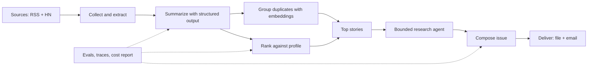

<div dir="rtl" lang="he">

# פרק 0: איך ללמוד מהספר הזה

הספר הזה נכתב בשבילך: מפתחת תוכנה מנוסה (C++‎, Rust, Python) שמשתמשת בכלי AI כל יום, אבל טרם בנתה
מערכת שמודל שפה הוא אחד מרכיביה. המטרה שלו ממוקדת: בתוך 16 שבועות, בשעה עד שעתיים ביום, להביא
אותך למצב שבו את יכולה להתמודד על משרת הנדסת AI יישומית (Applied AI Engineering), לעבור ראיונות
טכניים ותכנון מערכות, ולהציג פרויקט אמיתי שבנית. הפרק הזה מסביר איך הספר בנוי ואיך להפיק ממנו את
המרב. קראי אותו עד הסוף לפני שאת מתחילה: הוא קצר, והוא ישפיע על כל יום לימוד שאחריו.

## מה נלמד בפרק

- מה הספר מבטיח, ומה הוא לא.
- איך הספר בנוי: חלקים, פרקים, תרגילים והפרויקט המסכם.
- שיטת הלמידה היומית, ומה עושים כשמפגרים אחרי הלוח.
- איך כותבים פתקי Obsidian שבאמת עוזרים, ואיך לקרוא עברית מימין לשמאל בלי להתעצבן.
- כמה הלימוד עולה (כמעט כלום) ואיך שומרים על זה.
- כללי יושר שחלים על כל תוצר שתציגי למעסיק.

## ידע מקדים

אין. הפרק מניח רק שאת יודעת לתכנת ולהשתמש בטרמינל.

## 0.1 למי הספר, ומה הוא מבטיח

הנדסת AI יישומית היא בניית מוצרים ושירותים סביב מודלים קיימים: מודלי שפה גדולים (Large Language
Models, בקיצור LLM) שחברות כמו Google, OpenAI ו־Anthropic מאמנות ומגישות דרך ממשק תכנות (API). את לא
תאמני מודל בספר הזה. את תלמדי לקרוא למודל נכון, לתת לו מידע, להגביל את הפלט שלו למבנה שהקוד יכול
לסמוך עליו, לחבר אותו לכלים, למדוד אם הוא עושה עבודה טובה, ולהפעיל את כל זה בצורה אמינה, זולה
ובטוחה. אלה המיומנויות שמודעות הדרושים מבקשות ב־2026, ואלה המיומנויות שהפרויקט המסכם מדגים.

מה הספר מבטיח, אם תעשי את העבודה:

- להסביר, בלי לקרוא מהדף, איך מודל שפה עובד ברמה שמספיקה להחלטות הנדסיות.
- לבנות מערכת שמשתמשת במודל, עם פלט מובנה, כלים, אחזור מידע, הערכה, בדיקות, מעקב ועלות ידועה.
- לדבר בביטחון על החלטות ארכיטקטורה ועל החלופות שדחית, בראיון ובסקירת תכנון.
- להציג ב־GitHub פרויקט שלם, מתועד ומדיד.

מה הספר לא עושה: לא מלמד מתמטיקה מעבר למינימום ההכרחי, לא מלמד לאמן מודלים מאפס, לא מכסה כל
ספרייה בשוק, ולא מבטיח משרה. הוא נותן בסיס, פרויקט ודרך לבדוק את המוכנות שלך.

## 0.2 איך הספר בנוי

הספר מחולק לתשעה חלקים ו־32 פרקים. תוכן העניינים המלא, עם מצב הכתיבה של כל פרק, נמצא בקובץ
`book/README.md`.

| חלק | פרקים | מה תוכלי לעשות בסופו |
| --- | --- | --- |
| א: התמצאות וסביבת עבודה | 1–2 | להבין את התפקיד ולהריץ קריאה ראשונה למודל ב־Windows |
| ב: איך מודלים עובדים | 3–6 | להסביר מודל, אימון, טוקנים, הסתברות, דגימה ומגבלות |
| ג: בנייה עם ממשקי מודלים | 7–11 | לכתוב קוד שמדבר עם מודל: הנחיות, פלט מובנה, כלים, הזרמה, שגיאות |
| ד: Embeddings, אחזור ו־RAG | 12–15 | לבנות חיפוש סמנטי ומערכת שעונה מתוך מסמכים עם מקורות |
| ה: הערכה ואיכות | 16–18 | למדוד איכות, לנתח כשלים ולכתוב בדיקות למערכת לא דטרמיניסטית |
| ו: סוכנים ותהליכי עבודה | 19–21 | לבנות סוכן שמשתמש בכלים, לשלוט בו, ולדעת מתי LangGraph מוצדק |
| ז: פרודקשן | 22–26 | מעקב, עלות, אמינות, אבטחה, פריסה, ובחירת מודל ושיטה |
| ח: קריירה | 27–29 | ראיונות תכנון מערכות, בנק שאלות, תיק עבודות וקורות חיים |
| ט: הפרויקט המסכם | 30–32 | Morning Brief: סוכן עיתון בוקר אישי, מתוכנן, בנוי, מוערך ומפורסם |

כל פרק בנוי באותה צורה, כדי שתדעי תמיד איפה את:

1. פתיחה קצרה: מה הפרק נותן ולמה זה חשוב לעבודה.
2. „מה נלמד בפרק” ו„ידע מקדים”.
3. סעיפים ממוספרים (2.1, 2.2 וכן הלאה). לוח הלימוד מפנה אליהם.
4. בסוף כל פרק, תמיד באותו סדר: סיכום, מונחים לזכור, טעויות נפוצות, שאלות ראיון, פתק Obsidian מוכן,
   תרגיל, והעשרה אופציונלית.

התרגילים נמצאים בתיקייה `exercises`, תיקייה אחת לכל פרק, ובה תמיד אותו מבנה:

| מה בתיקייה | תפקיד |
| --- | --- |
| `README.md` | המטרה, הזמן המשוער, הצעדים המדויקים, רשימת בדיקה ורמזים |
| `starter/` | קוד התחלה עם סימוני `TODO` |
| `solution/` | פתרון מלא, והסבר מה הוא מדגים |
| `tests/` | בדיקות אוטומטיות, כשיש |

הכלל: קודם מנסים לבד לפי הצעדים, ורק אז משווים לפתרון.

הפרויקט המסכם לא מחכה לסוף. כמעט כל תרגיל בספר בונה רכיב שהפרויקט ישתמש בו: סכמת הסיכום מפרק 9,
לולאת הכלים מפרק 10, המתאם לספק מפרק 11, זיהוי כפילויות מפרק 12, מערך ההערכה מפרק 16, המעקב מפרק
22. כשתגיעי לחלק ט, רוב החלקים כבר יהיו בידייך.

## 0.3 שיטת הלמידה היומית

הלוח המלא נמצא בנספח ו: 16 שבועות, חמישה ימי לימוד בשבוע (ראשון עד חמישי), 80 ימי לימוד, בין 75
ל־120 דקות ליום. לכל יום מוגדרים: הנושא, מטרת הלמידה, הסעיפים לקריאה, הזמן המשוער, התרגיל, קריטריון
סיום, ומה את אמורה להיות מסוגלת להסביר אחר כך.

יום לימוד טיפוסי נראה כך:

| שלב | זמן | מה עושים |
| --- | --- | --- |
| קריאה | 25–40 דקות | קוראים את הסעיפים של היום. לא מעתיקים הגדרות; מסמנים מה לא ברור. |
| הרצה | 40–70 דקות | עובדים על התרגיל לפי הצעדים. מריצים כל פיסת קוד. משווים לפלט הצפוי. |
| פתק | 10 דקות | כותבים פתק Obsidian במילים שלך (סעיף 0.4). |
| הסבר בקול | 5 דקות | עונים בקול על „מה את יכולה להסביר עכשיו” מהלוח. אם זה לא יוצא, חוזרים לקטע. |

ארבעה כללים שחשובים יותר מהלוח עצמו:

- **סיום נמדד בקריטריון, לא בשעון.** אם התרגיל לא עבר את קריטריון הסיום, ממשיכים אותו למחרת לפני
  שמתחילים יום בנייה חדש. קריאה תאורטית מותר לדחות; תרגיל לא.
- **מפגרים? קודם מוותרים על „אופציונלי”.** אחר כך ממזגים יום חזרה. אף פעם לא מדלגים על נקודת
  ביקורת (checkpoint, יש שש כאלה).
- **יום חזרה הוא יום לימוד.** ימי החזרה ונקודות הביקורת הם המקום שבו הידע נדבק. אל תחליפי אותם
  בעוד פרק.
- **שני ימים רצופים אפשר למזג למפגש אחד בסוף השבוע**, אם זה הקצב שלך. אל תמזגי שלושה.

## 0.4 פתקי Obsidian: הכלי שהופך קריאה לידע

לכל פרק מצורף פתק מוכן (בסוף הפרק, וגם כקובץ בתיקייה `obsidian/`). הוא לא מחליף את הפתק שלך; הוא
דוגמה למה פתק טוב מכיל. פתק טוב הוא קצר (עד 20 שורות), כתוב במילים שלך, מכיל דוגמה קונקרטית אחת
לפחות, ומסתיים בשאלה אחת שעדיין פתוחה אצלך. פתק רע הוא העתקה של הגדרות מהספר.

מבנה מומלץ (התבנית המלאה בנספח ד):

> **מה זה.** משפט או שניים במילים שלך.
> **למה זה חשוב לי.** איפה זה פוגש אותך בעבודה או בפרויקט.
> **דוגמה.** פיסת קוד, פלט, או מספר שראית בעצמך.
> **טעות שעשיתי או כמעט עשיתי.**
> **שאלה פתוחה.**
> **קישורים.** לפתקים אחרים שלך (`[[...]]`).

הקמת Obsidian לקורס, פעם אחת:

1. צרי כספת (vault) חדשה בשם `ai-course-notes`, או תיקייה חדשה בכספת קיימת.
2. התקיני את התוסף הקהילתי בשם RTL Support והפעילי אותו. הדרך: הגדרות, ואז Community plugins, ואז
   Browse, וחיפוש של השם. בהגדרות התוסף בחרי כיוון ברירת מחדל מימין לשמאל. כל פתק שהספר מספק מסומן
   ככזה בכותרת העליונה שלו, והתוסף מכבד את הסימון.
3. העתיקי את קובץ העיצוב של הספר לתיקיית ה־snippets שבכספת והפעילי אותו (הגדרות, ואז Appearance,
   ואז CSS snippets). הוא דואג שקוד יוצג משמאל לימין גם בתוך פתק עברי. מיקום הקובץ בחבילת הספר:
   `obsidian/snippets/book-rtl.css`. יעד ההעתקה בתוך הכספת: `.obsidian/snippets/`.
4. העתיקי את הפתקים המוכנים (התיקייה `obsidian` בחבילת הספר) לתיקייה `book` בכספת. את הפתקים שלך
   כתבי בתיקייה נפרדת בשם `mine`.

## 0.5 איך לקרוא את הספר בנוחות

הספר כתוב בעברית, מימין לשמאל. קוד, פקודות, שמות קבצים, שמות ספריות ומונחים טכניים נשארים באנגלית,
כי אלה המילים שתפגשי בקוד, בתיעוד ובמודעות הדרושים. כל מונח חשוב מופיע בפעם הראשונה בעברית ולצידו
האנגלית בסוגריים, למשל „חלון הקשר (context window)”.

יש שלוש דרכים לקרוא:

| דרך | איך | מתי מתאים |
| --- | --- | --- |
| גרסת HTML (מומלץ) | הפיקי את הדפים בפקודה שלמטה, ופתחי בדפדפן את הקובץ `index.html` שבתיקייה `site` | קריאה רציפה. הכיוון, הקוד והטבלאות מעוצבים נכון. |
| Obsidian | פתחי את התיקייה `book/` כחלק מהכספת, עם התוסף RTL Support | כשרוצים לקשר מהפתקים שלך ישירות לפרק. |
| GitHub או VS Code | תצוגה מקדימה של Markdown | מספיק טוב, פחות נוח; הקוד תמיד משמאל לימין. |

הפקת גרסת ה־HTML, פעם אחת אחרי כל עדכון של הספר, מתוך תיקיית הקורס:

<div dir="ltr" align="left">

```powershell
uv run --with markdown tools/build_html.py
```

</div>

שתי הערות סגנון: הספר פונה אלייך בלשון נקבה, כי הוא נכתב בשבילך. וקטעי הקוד מכילים הערות באנגלית
בלבד, כדי שהקוד יישאר „נקי” מימין לשמאל; ההסבר מגיע תמיד אחרי הקטע, בעברית.

## 0.6 כמה זה עולה, ואיך שומרים שזה יישאר כך

הספר משתמש בממשק ה־Gemini של Google במסלול החינמי (free tier). בלי כרטיס אשראי, בלי תשלום. נכון
לאוקטובר 2026 המסלול החינמי כולל את מודלי Flash ו־Flash-Lite ואת מודל ה־embedding, בכפוף למגבלות
קצב: מספר בקשות לדקה ומספר בקשות ליום, שמוצגים בחשבון שלך ב־Google AI Studio. בפרק 2 תפתחי מפתח
ותראי את המגבלות שלך בעצמך.

שלושה דברים שחשוב לדעת כבר עכשיו:

- **ימים שמסומנים בלוח ב־💲 מבצעים הרבה קריאות**, ועלולים להגיע למגבלת הדקה. התרגיל אז מחכה או
  מפזר את הקריאות. זה לא תקלה; ככה שירות אמיתי מתנהג מול מגבלת קצב, ונלמד לטפל בזה כמו שצריך.
- **במסלול החינמי Google רשאית להשתמש בתוכן הבקשות כדי לשפר את מוצריה.** לקורס זה בסדר: כל החומר
  ציבורי או מומצא. לפרויקט המסכם, שמכיל את פרופיל תחומי העניין שלך, אפשר לבחור: להישאר במסלול
  החינמי, או לשלם מראש 5 דולר פעם אחת ולעבור ל־Tier 1, שבו התוכן לא משמש לאימון והמגבלות גבוהות
  יותר. במחירים של היום 5 דולר מספיקים לחודשים של עיתון יומי. פרק 25 מראה את שתי הדרכים.
- **מפתח ה־API הוא סיסמה.** הוא נשמר בקובץ `.env` שלא נכנס ל־Git לעולם, לא מודבק בצ'אט, בצילום
  מסך או בקוד. אם דלף, מבטלים אותו ומנפיקים חדש. פרק 2 מסדר את זה נכון מהרגע הראשון.

## 0.7 כללי יושר לתיק העבודות

כל מה שתציגי למעסיק צריך לעמוד בשלושה כללים, והספר אוכף אותם בכל תרגיל:

1. **אומרים בדיוק מה הורץ.** תוצאה שלא מדדת לא מתוארת כנמדדת. „בדקתי 30 שאלות וקיבלתי 26 נכונות”
   ולא „המערכת מדויקת”.
2. **כל הנתונים ציבוריים או מומצאים.** אף שורת קוד, מסמך, שם פנימי או תקרית מהעבודה שלך, הנוכחית או
   הקודמת, לא נכנסים לקורס או לפרויקט. זו לא רק זהירות משפטית; זה מה שמאפשר לפרסם את הפרויקט.
3. **מפרידים בין „עובד אצלי” ל„מוכן לייצור”.** ה־README של הפרויקט אומר מה נבדק, מה לא, ומה היית
   מוסיפה לפני שימוש אמיתי. מראיינים מעריכים את ההבחנה הזאת יותר מכל רשימת טכנולוגיות.

## 0.8 מה עושים כשנתקעים

את תיתקעי. זה חלק מהלימוד, ובמיוחד בתחום שבו הכלים משתנים כל כמה חודשים. סדר הפעולות המומלץ:

1. קראי את הודעת השגיאה עד הסוף. ברוב המקרים היא אומרת בדיוק מה חסר.
2. בדקי את נספח ב (פתרון תקלות): הוא מרכז את התקלות הנפוצות של כל התקנה בספר, לפי הודעת השגיאה.
3. בדקי שאת בתיקייה הנכונה (`pwd` ב־PowerShell מדפיס אותה) ושהסביבה פעילה (`uv run` דואג לזה).
4. השתמשי בעוזר AI, אבל נכון: בקשי ממנו להסביר את השגיאה או את המושג, לא לכתוב לך את התרגיל. אם
   את מדביקה קוד, הסירי קודם כל מפתח או נתון אישי. ואמתי כל טענה טכנית מול התיעוד הרשמי, כי עוזרי
   AI טועים בפרטים של ספריות שהתעדכנו לאחרונה. זה בדיוק מה שקרה לטיוטה הראשונה של התוכנית הזאת.
5. אם אחרי 30 דקות עדיין תקוע: כתבי בפתק מה ניסית, ועברי הלאה. חזרי לזה ביום החזרה הקרוב.

## 0.9 הפרויקט המסכם בעמוד אחד: Morning Brief

בכל בוקר ב־07:00 את מקבלת תדריך קצר: 8 עד 12 הסיפורים שחשובים לך מתוך מקורות שבחרת (RSS ו־Hacker
News), כל אחד עם סיכום נאמן למקור בשלוש נקודות, שורה על „למה זה רלוונטי לך”, קישורים למקורות, ציון
„סוקר גם ב־...” כשכמה מקורות דיווחו על אותו סיפור, ו„המשך לסיפור מיום שלישי” כשכבר ראית אותו.
שלושת הסיפורים הראשונים מקבלים פסקת הקשר נוספת שאסף סוכן קטן ומוגבל. גיליון עולה אגורות (או כלום,
במסלול החינמי), לעולם לא נשלח פעמיים, שורד מקור שנפל, מתעלם מהוראות שהוחבאו בתוך כתבה, וכל טענה
בו מקושרת למקור.

<div dir="ltr" align="left">



</div>

הפרויקט נבנה בתשע אבני דרך (פרק 31), ולכל אבן דרך יש מטרה, צעדים מדויקים, תבניות התחלה, בדיקות
וקריטריון סיום. הוא משלב כמעט כל נושא בספר, ואת תוכלי להסביר כל תיבה בתרשים הזה, ואת החלופה
שדחית.

## סיכום

- הספר מכשיר למשרת הנדסת AI יישומית: שימוש נכון במודלים קיימים, לא אימון מודלים.
- 32 פרקים בתשעה חלקים, מבנה קבוע לכל פרק, תרגיל לכל שיעור, ופרויקט שנבנה מרכיבי התרגילים.
- יום לימוד: קריאה, הרצה, פתק, הסבר בקול. סיום לפי קריטריון, לא לפי שעון.
- פתקים במילים שלך ב־Obsidian, עם התוסף RTL Support.
- עלות: אפס במסלול החינמי; המפתח הוא סיסמה.
- יושר: אומרים מה הורץ, נתונים ציבוריים בלבד, מפרידים בין דמו לייצור.

## מונחים לזכור

| מונח בעברית | באנגלית | במשפט אחד |
| --- | --- | --- |
| הנדסת AI יישומית | Applied AI Engineering | בניית מוצרים סביב מודלים קיימים, עם מדידה ותפעול |
| מודל שפה גדול | Large Language Model (LLM) | מודל שמקבל טקסט ומייצר המשך סביר, טוקן אחר טוקן (פרק 5) |
| ממשק תכנות | API | הדרך שבה הקוד שלך מדבר עם המודל של הספק |
| מסלול חינמי | Free tier | שימוש ב־API ללא תשלום, עם מגבלות קצב ותנאי שימוש בתוכן |
| מגבלת קצב | Rate limit | מספר הבקשות המותר לדקה או ליום |
| קריטריון סיום | Completion criterion | התנאי הנמדד שאומר שיום הלימוד הושלם |

## טעויות נפוצות

- **לקרוא בלי להריץ.** הקריאה נותנת תחושת הבנה; ההרצה בודקת אותה. בלי הרצה אין יום לימוד.
- **להציץ בפתרון אחרי חמש דקות.** הפתרון נועד להשוואה אחרי ניסיון אמיתי. התקיעה היא הלמידה.
- **להעתיק הגדרות לפתק.** פתק שהוא העתק של הספר לא עוזר בראיון. במילים שלך, עם דוגמה.
- **לדלג על ימי ההערכה והבדיקות כי „זה פחות מעניין”.** אלה בדיוק המיומנויות שמודעות הדרושים
  מבקשות ושמועמדים לרוב חסרים.
- **לשים מפתח API בקוד „רק לבדיקה”.** אין „רק לבדיקה”. פרק 2 מסדר את זה נכון מההתחלה.

## שאלות ראיון

לפרק הזה אין שאלות ראיון; במקומן, שלוש שאלות לעצמך לפני שמתחילים:

1. איזה תפקיד אני רוצה בעוד חצי שנה, ומה בו שונה מהתפקיד שלי היום?
2. אילו שלוש יכולות אני כבר מביאה מהרקע שלי?
3. אילו שלוש יכולות חסרות לי היום, ואיפה בספר הן נלמדות?

## פתק Obsidian

הפתק המוכן נמצא גם כקובץ: `obsidian/00-how-to-study.md`. זה תוכנו:

- **הקצב שלי:** חמישה ימים בשבוע, 75 עד 120 דקות. ימי הלימוד: ___ . השעה הקבועה: ___ .
- **כלל הזהב:** יום נגמר כשקריטריון הסיום מתקיים, לא כשהשעון נגמר.
- **כשאני מפגרת:** קודם מוותרת על „אופציונלי”, אחר כך ממזגת יום חזרה. לא מדלגת על נקודת ביקורת.
- **כשאני נתקעת:** קוראת את הודעת השגיאה עד הסוף, בודקת בנספח ב, בודקת תיקייה וסביבה, שואלת עוזר AI
  להסבר בלבד, רושמת פתק וממשיכה.
- **יושר:** אומרת מה הרצתי. נתונים ציבוריים בלבד. דמו הוא לא ייצור.
- **עלות:** המסלול החינמי. המפתח הוא סיסמה, ונשמר רק בקובץ הסודות.
- **שאלה פתוחה:** ___

## תרגיל

**מטרה:** להכין את סביבת הלמידה (לא את סביבת הפיתוח; זו בפרק 2) ולכתוב את הפתק הראשון.
**זמן:** 30–40 דקות. **ידע מקדים:** אין.

1. הקימי את כספת Obsidian כמתואר בסעיף 0.4, כולל התוסף RTL Support וקובץ ה־CSS.
2. העתיקי את הפתק המוכן של פרק 0 (`obsidian/00-how-to-study.md`) לתיקייה `book/` בכספת, ואת תבנית
   הפתק (נספח ד) לתיקייה `mine/`.
3. בחרי את ימי הלימוד והשעה הקבועה שלך לשבועיים הקרובים, ורשמי אותם בפתק.
4. הפיקי את גרסת ה־HTML של הספר: מתיקיית הקורס הריצי `uv run --with markdown tools/build_html.py`
   ופתחי `site/index.html`. (אם `uv` עדיין לא מותקן אצלך, זה בסדר: הצעד הזה חוזר בפרק 2.)

**קריטריון סיום:** הכספת קיימת, הפתק של פרק 0 מוצג מימין לשמאל, והקוד בתוכו מוצג משמאל לימין.

## העשרה אופציונלית

- הפרק הראשון של הספר *AI Engineering* מאת Chip Huyen נותן תמונת־על טובה של התחום. לא נדרש
  להמשך; מתאים למי שאוהבת לראות את המפה כולה לפני הצעד הראשון.

</div>
