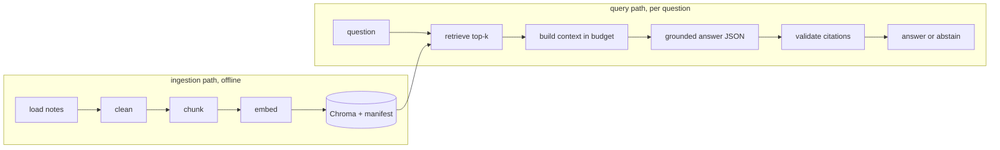

<div dir="rtl" lang="he">

# פרק 15: RAG מקצה לקצה

„יצירה מועשרת באחזור” (retrieval-augmented generation, RAG) היא הרכבה של כל מה שלמדת: מסמכים
נטענים, נחתכים לקטעים, משוכנים ונשמרים במאגר (פרקים 12 עד 14); שאלה מאחזרת את הקטעים הקרובים
(פרק 13); הקטעים נכנסים להנחיה כמקורות ממוספרים (פרק 8); המודל עונה בפלט מובנה עם ציטוטים (פרק 9)
דרך הלקוח העמיד (פרק 11); והקוד מאמת את הציטוטים ונמנע מתשובה כשאין בסיס. הפרק מלמד את שני
המסלולים, את ההחלטות שבכל שלב, את ההשוואה להקשר ארוך, את מטמון ההנחיות, ואת הדבר שמבדיל מערכת
RAG שעובדת ממערכת שמרשימה בהדגמה: דיבוג לפי שלבים. בסופו, נקודת ביקורת 3: `ask_notes`, שאלות
על פתקי הקורס שלך, עם ציטוטים, הימנעות, מעקב והזרקת תקלות.

## מה נלמד בפרק

- שני המסלולים: קליטה ושאילתה.
- טעינה וניקוי של Markdown, HTML ו־PDF.
- חלוקה לקטעים: שתי אסטרטגיות, חפיפה, מזהים יציבים, מטא־נתונים.
- אינדוקס אינקרמנטלי: הרצה חוזרת שעושה רק מה שהשתנה.
- אחזור, `top_k`, ובניית הקשר בתוך תקציב.
- תשובה מעוגנת עם ציטוטים ממוספרים, אימות ציטוטים, הימנעות.
- שכתוב שאילתה, היברידי, הקשר ארוך מול RAG, מטמון הנחיות.
- דיבוג לפי שלבים, טקסונומיית כשלים, ומה לרשום במעקב.

## ידע מקדים

פרקים 8 עד 14. התרגיל קורא ל־API; האינדוקס של הפתקים משתמש במטמון השיכונים.

## 15.1 שני המסלולים

<div dir="ltr" align="left">



</div>

מסלול הקליטה רץ כשהמסמכים משתנים; מסלול השאילתה רץ לכל שאלה. ההפרדה חשובה בגלל עלות: קליטה
משלמת שיכון פעם אחת לכל קטע; שאילתה משלמת שיכון אחד ועוד קריאת מודל אחת. רוב הבאגים ב־RAG הם
בקליטה, והם מתגלים רק בשאילתה; זו הסיבה שסעיף 15.13 קיים.

## 15.2 טעינה וניקוי

הטוען (loader) הופך קובץ ל־`Document`: נתיב, כותרת, טקסט נקי, וגיבוב תוכן. ניקוי פירושו להסיר מה
שאין לו משמעות לאחזור: הכותרת העליונה (front matter) של Obsidian, עטיפות HTML, תפריטים. בפתקים
של הקורס זה גם ה־`<div dir="rtl">`; אם היינו משאירים אותו, הוא היה נכנס לכל קטע ראשון ומושך
אליו שאילתות על „div”.

| פורמט | כלי | מלכודת |
| --- | --- | --- |
| Markdown | קריאה ישירה; ביטוי רגולרי לכותרת העליונה | כותרות הן מידע מבני: שומרים אותן לחלוקה |
| HTML | `trafilatura` (פרק 10) | טקסט של תפריטים ותגובות; `include_comments=False` |
| PDF | `pypdf` או `pdfplumber` (לא בערימה שלנו; מתקינים כשצריך) | עמודות, כותרות עליונות חוזרות, טבלאות שנמעכות לשורה אחת |

גיבוב התוכן (`sha256` של הטקסט הנקי) הוא מה שיאפשר לסעיף 15.4 לדעת אם מסמך השתנה בלי לקרוא
אותו מול המאגר.

## 15.3 חלוקה לקטעים

**קטע הוא יחידת ראיה** (unit of evidence): מה שהמודל יקבל כמקור ממוספר ומה שתוכלי לצטט. גדול מדי,
והוא מדלל את ההקשר ומבזבז את התקציב; קטן מדי, והוא מאבד את ההקשר שלו עצמו („זה” מתייחס למשפט
שנשאר בקטע הקודם).

| אסטרטגיה | איך | יתרון | חיסרון |
| --- | --- | --- | --- |
| גודל קבוע עם חפיפה | 800 תווים, חפיפה של 100, חיתוך ברווח | פשוט, צפוי, עובד על כל טקסט | חותך באמצע רעיון; החפיפה מכפילה טקסט |
| לפי כותרות | קטע לכל סעיף Markdown; סעיף ארוך מתפצל לקבוע | שומר על משמעות; הכותרת היא מטא־נתון חינם | תלוי במחבר; סעיפים לא אחידים |
| סמנטי | חיתוך איפה שהשיכון של משפטים עוקבים „קופץ” | גבולות טבעיים | יקר, ולא תמיד טוב יותר |

**חפיפה** (overlap) היא ביטוח נגד חיתוך באמצע: המשפט שנחתך מופיע בשני הקטעים. 10 עד 15 אחוז
מגודל הקטע הוא נקודת התחלה טובה. **גודל** נמדד בתווים אצלנו, לפשטות; תקציב ההקשר (15.6) מתורגם
לטוקנים בערך ביחס של ארבעה תווים לטוקן באנגלית, פחות בעברית (פרק 5).

כל קטע נושא מטא־נתונים: הנתיב, הכותרת של הסעיף, והמיקום במסמך. השניים הראשונים מופיעים בכותרת
של המקור בהקשר („notes/11-robust-clients.md › ניסיונות חוזרים”) ועוזרים גם למודל וגם לקוראת.

## 15.4 מזהים יציבים ואינדוקס אינקרמנטלי

מזהה הקטע הוא **גיבוב של הנתיב והטקסט** (content-addressed): אותו קטע, אותו מזהה, בכל מכונה ובכל
הרצה; עריכה משנה את המזהה. בלי זה, הרצה חוזרת של הקליטה הייתה מכפילה את האוסף או דורסת קטעים
בלי קשר.

מעליו, **מניפסט**: קובץ JSON קטן שממפה כל מסמך לגיבוב התוכן שלו ולרשימת מזהי הקטעים שלו. הסנכרון
עובד כך:

| מצב המסמך | פעולה |
| --- | --- |
| במניפסט, אותו גיבוב | דילוג. אפס קריאות שיכון |
| במניפסט, גיבוב אחר | מחיקת הקטעים הישנים לפי מזהה, חלוקה, שיכון, upsert, עדכון המניפסט |
| לא במניפסט | חלוקה, שיכון, upsert, הוספה למניפסט |
| במניפסט אבל הקובץ נעלם | מחיקת הקטעים, הסרה מהמניפסט |

התוצאה: `sync` **אידמפוטנטי**. מריצים אותו בכל פעם, והוא עושה רק מה שהשתנה. `SyncReport` מחזיר
את המספרים (נוספו, עודכנו, דולגו, הוסרו, שוכנו), והם נכנסים למעקב: הרצה שמדווחת „12 שוכנו” כשלא
שינית כלום היא באג בגיבוב.

## 15.5 אחזור ו־top_k

מסלול השאילתה מתחיל בפרק 13: חיפוש צפוף באוסף, או היברידי עם BM25 על כל הקטעים ו־RRF. כמה
קטעים? **k קטן** (3 עד 5) נותן הקשר ממוקד וזול; **k גדול** (10 ומעלה) מעלה את הסיכוי שהעובדה
בפנים, ומוריד את תשומת הלב של המודל לכל קטע. הכלל: k נבחר לפי recall@k מדוד (פרק 13) ולפי
תקציב ההקשר, לא לפי תחושה. בהיברידי, המועמדים (20) גדולים מ־k, והאיחוד מצמצם.

## 15.6 בניית הקשר בתוך תקציב

הקטעים שאוחזרו הופכים לטקסט אחד של מקורות ממוספרים:

<div dir="ltr" align="left">

```text
[1] (10-tool-calling.md › משגר)
...טקסט הקטע...

[2] (11-robust-clients.md › ניסיונות חוזרים שלא מזיקים)
...
```

</div>

שלוש החלטות:

- **תקציב.** מוסיפים קטעים לפי סדר הדירוג עד שהתווים נגמרים (6,000 בתרגיל). מה שלא נכנס לא
  קיים, ולכן הפונקציה מחזירה גם את **רשימת הקטעים שנכנסו**: רק הם ציטוטים חוקיים.
- **מספור, לא כתובות.** המודל מצטט `[2]`, לא נתיב או URL. מספרים קצרים הוא מעתיק בלי טעויות;
  כתובות הוא ממציא.
- **הסדר בהנחיה: מקורות קודם, שאלה בסוף.** המקורות הם החלק הארוך ולעיתים החוזר; השאלה משתנה.
  ככה הקידומת של ההנחיה יציבה, וזה מה שסעיף 15.12 מנצל.

## 15.7 תשובה מעוגנת עם ציטוטים

הוראות המערכת אומרות: ענה רק מהמקורות, בשפת השאלה, עם מספרי מקורות אחרי כל משפט עובדתי, ואם
המקורות לא מכילים את התשובה, החזר תשובה ריקה ו־`supported=false`. הפלט מובנה (פרק 9):

<div dir="ltr" align="left">

```python
class GroundedAnswer(BaseModel):
    answer: str          # empty when the sources do not contain it
    citations: list[int] # source numbers that support the answer
    supported: bool      # true only if every claim is stated in the cited sources
```

</div>

ואז הקוד **מאמת**: ציטוט חוקי הוא מספר בין 1 למספר הקטעים שנכנסו להקשר. `[7]` כשנכנסו חמישה הוא
ציטוט מומצא; מסירים אותו ורושמים אותו במעקב (זה אות אזהרה על המודל או על ההנחיה). תשובה נחשבת
מעוגנת רק אם `supported` אמת, יש לפחות ציטוט חוקי אחד, והטקסט לא ריק. אחרת, הימנעות.

ההבחנה החשובה: **מעוגן אינו נכון.** תשובה מעוגנת אומרת „המודל טוען שזה כתוב במקור 2”. האם זה באמת
כתוב שם, ואם מה שכתוב שם נכון, אלה שתי שאלות אחרות: הראשונה היא נאמנות (faithfulness) ונמדדת בחלק
ה; השנייה היא איכות המקורות.

## 15.8 הימנעות וכיסוי

מערכת שלא נמנעת לעולם עונה גם כשאין בסיס, ומערכת שנמנעת תמיד חסרת תועלת. שני המספרים שמודדים
את האיזון:

- **כיסוי** (coverage): מתוך השאלות שיש להן תשובה בפתקים, על כמה ענינו.
- **תשובות לא נתמכות** (unsupported): מתוך התשובות שנתנו, כמה לא היו מעוגנות באמת.

התרגיל דורש שלוש שאלות שיש להן תשובה ושתיים שאין, ובודק ששתי הקבוצות מתנהגות נכון. חלק ה
יהפוך את זה לסט הערכה אמיתי. עד אז הכלל: **כשיש ספק, להימנע.** בעיתון בוקר, „לא מצאתי” עדיף על
עובדה מומצאת עם ציטוט.

## 15.9 שכתוב שאילתה, בקצרה

לפעמים השאלה כפי שנכתבה לא דומה לקטע שעונה עליה. שתי טכניקות נפוצות:

- **ריבוי שאילתות** (multi-query): לבקש מהמודל שלושה ניסוחים של השאלה, לאחזר לכל אחד, ולאחד עם
  RRF. מעלה recall, מכפיל את עלות האחזור.
- **מסמך היפותטי** (HyDE): לבקש מהמודל תשובה משוערת ולאחזר *לפיה*; תשובה דומה יותר לקטע מאשר
  שאלה.

שתיהן מוסיפות קריאת מודל לכל שאלה. מוסיפים אותן רק כשסט השאילתות המתויג מראה שהאחזור הוא
הבעיה, לא הגנרציה.

## 15.10 היברידי ב־RAG

`Retriever(index, "hybrid")` בתרגיל בונה BM25 על כל הקטעים באוסף ומאחד אותו עם האחזור הצפוף
דרך RRF. זה מה שמציל שאלות כמו „מה זה E0502?”: הקטע שמכיל את המחרוזת מקבל דרגה ראשונה במילולי
גם אם השיכון שלו רחוק. בפתקים טכניים, היברידי הוא כמעט תמיד ברירת המחדל הנכונה.

## 15.11 הקשר ארוך מול RAG

מודלים עם חלון של מיליון טוקנים מעלים שאלה הוגנת: למה לא לשים את כל הפתקים בהנחיה? התרגיל
מודד את זה על חמש שאלות:

| | הכול בהקשר | RAG |
| --- | --- | --- |
| טוקני קלט לשאלה | כל האוסף (עשרות אלפים ומעלה) | k קטעים (אלפים) |
| עלות לשאלה | פי 10 עד 100 | נמוכה |
| זמן תגובה | ארוך | קצר |
| רעננות | צריך לשלוח הכול מחדש בכל שינוי | מסנכרנים את מה שהשתנה |
| ציטוטים | אפשריים, אבל קשה לאמת | טבעיים: המקורות ממוספרים |
| כשהאוסף גדול מהחלון | בלתי אפשרי | עובד |
| שאלות שדורשות את כל המסמך | טוב יותר | תלוי בחלוקה |

הקשר ארוך מנצח כשהאוסף קטן, השאלות מעטות, והתשובה דורשת הסתכלות על הכול („סכם את כל הפתקים”).
RAG מנצח כשיש הרבה שאלות, אוסף גדול או משתנה, או צורך בציטוטים. ובהרבה מערכות, שניהם: RAG
בוחר מסמכים שלמים, והקשר ארוך קורא אותם.

## 15.12 מטמון הנחיות

ספקי מודלים שומרים במטמון את **הקידומת** של הנחיה שחוזרת על עצמה, ומחייבים אותה בחלק מהמחיר
(ולעיתים מגיבים מהר יותר). אצל Gemini זה קורה אוטומטית (implicit caching) כשהקידומת זהה
וארוכה מספיק, והמינימום תלוי במודל (אלפי טוקנים). הכלל שמאפשר את זה הוא **כלל יציבות
הקידומת**: כל מה שקבוע, הוראות המערכת, הדוגמאות, המסמכים, נמצא בתחילת ההנחיה; מה שמשתנה,
השאלה, בסוף. שינוי של תו אחד בהתחלה מבטל את המטמון של כל מה שאחריו.

`Completion.cached_tokens` (פרק 11) מדווח כמה מטוקני הקלט הגיעו מהמטמון. התרגיל שולח את אותה
הנחיה ארוכה פעמיים ברצף ומראה את ההבדל. יש גם מטמון מפורש (explicit caching) שמנהלים ביד, עם
זמן חיים ותשלום על אחסון; הוא משתלם כשאותו הקשר גדול משרת עשרות שאלות.

## 15.13 דיבוג לפי שלבים וטקסונומיית כשלים

מערכת RAG נכשלת בשקט: התשובה נראית סבירה, רק שהיא לא נכונה. הדרך היחידה לדבג היא לדעת **באיזה
שלב הראיה נעלמה**, וזה דורש מעקב (trace) לכל שאלה:

| שלב | מה רושמים | הכשל שזה חושף |
| --- | --- | --- |
| טעינה | מספר המסמכים, `SyncReport` | מסמך חסר, גיבוב שבור |
| חלוקה | מספר הקטעים, גודל חציוני | קטע ענק (מסמך שלם), קטעים ריקים |
| אחזור | מזהים, נתיבים, כותרות וציונים של ה־k | הקטע הנכון לא אוחזר, או אוחזר במקום 9 |
| הקשר | כמה קטעים נכנסו, כמה תווים | הקטע הנכון נחתך מהתקציב |
| יצירה | גרסת ההנחיה, טוקנים, ניסיונות | הנחיה שמרשה להתעלם מההקשר |
| אימות | ציטוטים חוקיים ומומצאים, `supported`, הימנעות | ציטוט ל־`[7]` כשיש חמישה; תשובה בלי ציטוט |

התרגיל מזריק שלוש תקלות, ובכל אחת את מאתרת את השלב מהמעקב בלבד:

- **`drop-doc`**: המסמך הרלוונטי הוסר. במעקב: `documents` קטן באחד, הנתיב לא מופיע באחזור, הימנעות.
  כשל אחזור שמקורו בקליטה.
- **`break-chunking`**: קטע אחד לכל קובץ. במעקב: `indexed_chunks` שווה למספר המסמכים, הקשר של
  קטע אחד ענק שנחתך. כשל חלוקה.
- **`ignore-context`**: הוראות מערכת שמרשות לענות מהידע הכללי. במעקב: `prompt_variant` שונה,
  תשובה בטוחה בלי ציטוטים חוקיים, והאימות הופך אותה להימנעות. כשל יצירה שהאימות תפס.

טקסונומיה קצרה של כשלי RAG, לפי שלב: מסמך חסר; ניקוי שהשאיר רעש; חלוקה שחתכה את הראיה; אחזור
שהחמיץ (מילולי מול צפוף); הקשר שנחתך בתקציב; מודל שהתעלם מההקשר; ציטוט מומצא; תשובה לא נתמכת
עם ציטוט חוקי (הכשל הקשה ביותר, ונושא של חלק ה). לכל אחד יש שורה במעקב שמסגירה אותו.

## 15.14 בפרויקט

- **משמעת ציטוטים באבן דרך 5:** כשסוכן המחקר מוסיף עובדות מדפים שהוריד, כל עובדה מצטטת מקור
  ממוספר מתוך הדפים שאוחזרו, והקוד מאמת בדיוק כמו כאן. עובדה בלי מקור חוקי לא נכנסת לעיתון.
- **„שאל את הארכיון”** היא הרחבה אופציונלית: RAG על כל העיתונים שפורסמו, עם `ask_notes` כבסיס.
- **מעקב לכל שלב** הוא הדבר הראשון שנבנה בפרויקט, לא האחרון.

## נקודת ביקורת 3: `ask_notes`

כלי שורת פקודה שעונה על שאלות מתוך תיקיית פתקים: אינדוקס אינקרמנטלי, אחזור צפוף או היברידי,
תשובה מעוגנת עם ציטוטים, הימנעות, מעקב JSON, ושלוש תקלות להזרקה. הוא רץ על פתקי הקורס שלך,
ונבדק בלי רשת. הפירוט בתרגיל.

## סיכום

- שני מסלולים: קליטה (טעינה, ניקוי, חלוקה, שיכון, מאגר) ושאילתה (אחזור, הקשר, תשובה, אימות).
- קטע הוא יחידת ראיה; גודל וחפיפה הם פשרה; כותרות הן מטא־נתונים חינם.
- מזהים מגיבוב התוכן ומניפסט נותנים סנכרון אידמפוטנטי שעושה רק מה שהשתנה.
- הקשר בתקציב, מקורות ממוספרים, שאלה בסוף; המודל מצטט מספרים; הקוד מאמת ונמנע.
- מעוגן אינו נכון; כיסוי מול תשובות לא נתמכות הם המספרים.
- הקשר ארוך לאוסף קטן ושאלות מעטות; RAG לאוסף גדול, הרבה שאלות, ציטוטים. קידומת יציבה
  למטמון.
- דיבוג לפי שלבים: מעקב שאומר איפה הראיה נעלמה.

## מונחים לזכור

| מונח בעברית | באנגלית | במשפט אחד |
| --- | --- | --- |
| יצירה מועשרת באחזור | retrieval-augmented generation (RAG) | אחזור קטעים רלוונטיים והכנסתם להנחיה |
| מסלול קליטה | ingestion path | טעינה, ניקוי, חלוקה, שיכון, שמירה |
| קטע | chunk | יחידת הראיה שנשלחת למודל ומצוטטת |
| חפיפה | overlap | טקסט משותף לקטעים סמוכים |
| מזהה לפי תוכן | content-addressed id | גיבוב של נתיב וטקסט; יציב בין הרצות |
| מניפסט | manifest | רשימת מסמכים עם גיבוב ומזהי קטעים, לסנכרון |
| תקציב הקשר | context budget | כמה תווים או טוקנים של מקורות נכנסים |
| תשובה מעוגנת | grounded answer | כל טענה מצטטת מקור שנכנס להקשר |
| הימנעות | abstention | „לא מצאתי” במקום תשובה בלי בסיס |
| נאמנות | faithfulness | האם מה שצוטט באמת כתוב במקור; נמדד בחלק ה |
| כלל יציבות הקידומת | prefix-stability rule | קבוע בהתחלה, משתנה בסוף, בשביל המטמון |
| מטמון הנחיות | prompt caching | חיוב מופחת על קידומת שחוזרת |

## טעויות נפוצות

- **לצטט כתובות.** המודל ממציא אותן. מספרים מתוך ההקשר, ואימות.
- **לקבל ציטוט בלי לבדוק שהוא בטווח.** `[7]` כשיש חמישה הוא המצאה.
- **להריץ קליטה מחדש על הכול.** מזהים לפי תוכן ומניפסט; אחרת כפילויות ועלות.
- **קטע = מסמך.** ההקשר נחתך, התשובה כללית. הזרקת התקלה הזאת בתרגיל מראה בדיוק איך זה נראה.
- **שאלה בתחילת ההנחיה ומקורות אחריה.** אין מטמון, והמודל רואה את השאלה רחוק מהמקורות.
- **לבחור k מהרגשה.** recall@k על סט מתויג.
- **„המערכת לא נמנעת אף פעם, יופי.”** זה אומר שהיא עונה גם בלי בסיס.

## שאלות ראיון

1. **תארי צינור RAG מקצה לקצה.** קליטה: טעינה וניקוי, חלוקה לקטעים עם מזהים לפי תוכן, שיכון,
   שמירה במאגר עם מטא־נתונים, ומניפסט לסנכרון אינקרמנטלי. שאילתה: אחזור (היברידי אם יש מזהים),
   הקשר ממוספר בתקציב, תשובה מובנית עם ציטוטים, אימות הציטוטים מול מה שנכנס, הימנעות כשאין
   בסיס. ומעקב בכל שלב.
2. **איך מונעים ציטוטים מומצאים?** המודל מצטט מספרים של מקורות שנכנסו להקשר, לא כתובות; הקוד
   בודק שכל מספר בטווח ומסיר את השאר; תשובה בלי ציטוט חוקי הופכת להימנעות; והמעקב סופר ציטוטים
   מומצאים כאות אזהרה.
3. **מתי הקשר ארוך עדיף על RAG?** אוסף קטן, שאלות מעטות, ושאלה שדורשת את כל המסמך. RAG כשיש
   הרבה שאלות, אוסף גדול או משתנה, או ציטוטים. העלות לשאלה היא ההבדל הגדול; מדדתי אותה.
4. **איך מדבגים מערכת RAG שעונה לא נכון?** לפי שלבים, מהמעקב: האם המסמך נטען, כמה קטעים, האם
   הקטע הנכון אוחזר ובאיזה מקום, האם הוא נכנס לתקציב ההקשר, איזו גרסת הנחיה רצה, ומה האימות
   מצא. כל כשל משאיר סימן בשלב אחר.

## פתק Obsidian

הפתק המוכן נמצא גם כקובץ: `obsidian/15-rag-end-to-end.md`. זה תוכנו:

- **שני מסלולים:** קליטה (טעינה, ניקוי, חלוקה, שיכון, מאגר) ושאילתה (אחזור, הקשר, תשובה, אימות).
- **קטע = יחידת ראיה.** קבוע 800 עם חפיפה 100, או לפי כותרות. מזהה = sha256(path, text).
- **מניפסט:** אותו גיבוב דילוג; אחר מחק ישנים ושכן; נעלם מחק. `sync` אידמפוטנטי.
- **הקשר:** מקורות `[n]` בתקציב תווים; רק מה שנכנס חוקי לציטוט; שאלה בסוף.
- **תשובה:** `{answer, citations, supported}`; אימות טווח; בלי ציטוט חוקי = הימנעות. מעוגן ≠ נכון.
- **הקשר ארוך מול RAG:** עלות לשאלה, רעננות, ציטוטים. **מטמון:** קידומת יציבה, `cached_tokens`.
- **דיבוג לפי שלבים:** מסמכים, קטעים, אחזור, הקשר, גרסת הנחיה, אימות.
- **שאלה פתוחה:** ___

<div dir="ltr" align="left">

```text
load      load_markdown_dir(root) -> Document(path, title, text, content_hash)
chunk     chunk_fixed(doc, 800, 100) | chunk_by_heading(doc, 1200)   id = sha256(path + "\x00" + text)[:16]
sync      NotesIndex(path, embedder, chunker).sync(docs) -> SyncReport(added, updated, skipped, removed, embedded)
retrieve  Retriever(index, "dense" | "hybrid").retrieve(question, k=5)
context   build_context(retrieved, max_chars=6000) -> (text, included); prompt = <sources> ... </sources> <question> ... </question>
answer    GroundedAnswer{answer, citations[int], supported}; valid = 1..len(included); none valid -> ABSTAIN
trace     documents, indexed_chunks, retrieved[], context_chunks/chars, prompt_variant, citations, invalid, cached_tokens
faults    --fault drop-doc | break-chunking | ignore-context
```

</div>

## תרגיל

**מטרה:** לבנות את `ask_notes`: אינדוקס אינקרמנטלי של פתקי הקורס, אחזור צפוף והיברידי, תשובה מעוגנת
עם ציטוטים ואימות, הימנעות, השוואה להקשר ארוך עם בדיקת מטמון, ודיבוג של שלוש תקלות מוזרקות מהמעקב.
**זמן:** ארבעה ימי לימוד (ימים 27 עד 30), כ־60 עד 70 דקות בנייה בכל אחד. **ידע מקדים:** הפרק,
התרגילים של פרקים 12 עד 14, ומפתח API.

הצעדים, קוד ההתחלה, הרמזים והפתרון נמצאים ב־
[`exercises/ch15-rag/README.md`](../exercises/ch15-rag/README.md).

**קריטריון סיום:**

- שתי חלוקות של הפתקים עם מספרי קטעים; הרצה שנייה של `sync` מדווחת אפס שיכונים.
- שלוש שאלות עם תשובה בפתקים מקבלות תשובה עם ציטוטים חוקיים; שתיים בלי תשובה מקבלות הימנעות.
- טבלת הקשר ארוך מול RAG על חמש שאלות, ובדיקת מטמון עם `cached_tokens` גדול מאפס בקריאה השנייה
  (או הסבר למה לא: קידומת קצרה מהמינימום).
- שלוש התקלות אותרו מהמעקב בלבד, עם השורה שהסגירה כל אחת, בפתק.
- שמונה הבדיקות עוברות בלי רשת; `ask_notes` מוכן למאגר עם README קצר.

## העשרה אופציונלית

- המאמר המקורי של RAG (Lewis et al., 2020), בשביל ההיסטוריה; המערכת שבנית שונה ממנו כמעט בכל
  פרט, וזה שיעור בפני עצמו.
- התיעוד של Gemini על context caching: המינימום לכל מודל, ומטמון מפורש.
- הפרק על RAG בספרה של Chip Huyen, ובמיוחד הדיון בחלוקה לקטעים ובהערכת אחזור.

</div>
