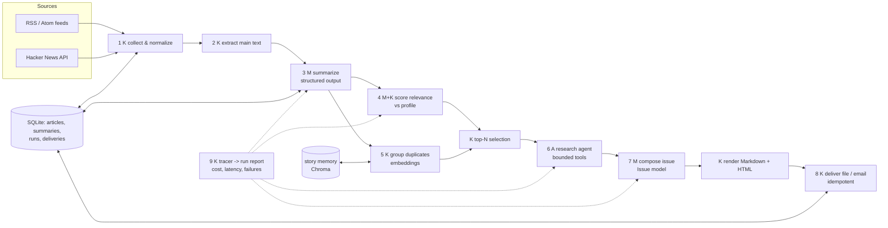

<div dir="rtl" lang="he">

# פרק 30: מפרט וארכיטקטורה

כל מה שלמדת נפגש כאן. **Morning Brief** הוא תהליך עבודה מתוזמן של תשעה שלבים, שרק אחד מהם הוא
סוכן. כל בוקר הוא מקבל כמה עשרות כתבות ממקורות שבחרת, ומגיש לך עיתון קצר: שמונה עד שתים־עשרה
ידיעות שחשובות *לך*, כל אחת עם סיכום נאמן של שלוש נקודות, שורה אחת למה זה חשוב לך, קישורים למקור,
„סוקר גם ב…” כשכמה מקורות כתבו על אותו דבר, ו„המשך לידיעה משלישי” כשראית אותה כבר. שלוש הידיעות
הראשיות מקבלות פסקת הקשר נוספת מסוכן מחקר תחום. גיליון עולה סנטים, לא נשלח פעמיים, שורד פיד מת
או ספק שנפל, מתעלם מהוראות השתולות בכתבות, וכל טענה בו מקושרת למקור. הפרק הזה הוא המפרט: סיפור
משתמשת, דרישות, שלבי הצינור, איך כל שלב נכשל ואיך מודדים אותו, מודל הנתונים, הציור, איפה המודל
ואיפה קוד, וההחלטות עם החלופות הפשוטות יותר. פרק 31 יהפוך אותו לתשע אבני דרך; פרק 32 יסגור
בהערכה ובראיון.

## מה נלמד בפרק

- סיפור המשתמשת והיקף: מה בפנים, מה בחוץ ולמה.
- דרישות פונקציונליות ולא־פונקציונליות, וכיצד כל אחת נבדקת.
- תשעת שלבי הצינור: קלט, פלט, האם מודל, איזו צורה, איזה מודול.
- לכל שלב: איך הוא נכשל, מה קורה אז בריצה, ואיך מודדים שהוא עובד.
- מודל הנתונים ב־SQLite וב־Chroma, ופרופיל הקוראת.
- הציור.
- טבלת ההחלטות: מה נבחר, מה היה פשוט יותר, ולמה.

## ידע מקדים

הספר כולו. הפרק מפנה לפרקים שבנו כל רכיב; אם משהו לא מוכר, זה הסימן לחזור אליו לפני אבן הדרך
המתאימה.

## 30.1 סיפור המשתמשת והיקף

> כל בוקר בשבע אני פותחת מייל אחד. בתוכו שלוש ידיעות עם הקשר ושאר הידיעות החשובות לי מהיום, כל
> אחת עם שלוש נקודות שאני יכולה לסמוך עליהן וקישור. אני לא רואה את אותה ידיעה פעמיים, ואם זה
> המשך של משהו שקראתי, כתוב לי שזה המשך. אם משהו נשבר בלילה, אני מקבלת עיתון חלקי עם הערה, לא
> כלום.

**בהיקף:** פידים ציבוריים (RSS/Atom) ו־Hacker News; קוראת אחת (את); משלוח לקובץ ולמייל; ריצה
יומית מתוזמנת; הערכה; תפעול. **מחוץ להיקף** (מתועד ב־README כ„הבא”): כמה משתמשות, הזדהות, ממשק
web, מקורות בתשלום, רשתות חברתיות, ו„שאל את הארכיון” כהרחבה אופציונלית. ההיקף הצר הוא החלטה: מערכת
שלמה וכנה בהיקף קטן שווה בראיון יותר ממערכת גדולה שחצייה חסר.

**הגרסה המינימלית** היא אבני הדרך 1 עד 5 של פרק 31: גיליון אמיתי אחד שמגיע במייל, מקצה לקצה. אבני
הדרך 6 עד 9 מקשיחות אותו (הערכה, תפעול, אבטחה, תזמון), וההרחבות (שער אישור ב־LangGraph, חיפוש
ברשת, „שאל את הארכיון”) באות רק אחרי שהכול ירוק. אם נגמר הזמן, מוותרים על הרחבה, לא על בדיקה.

## 30.2 דרישות

**פונקציונליות**

| # | דרישה | הפרק שבנה את זה |
| --- | --- | --- |
| F1 | איסוף פריטים מרשימת פידים ומ־Hacker News | 10 (רשת), 25 (קונפיגורציה) |
| F2 | נרמול, כפילויות לפי כתובת קנונית, חילוץ טקסט עם גבול | 10 (`trafilatura`), 15 (גיבוב תוכן) |
| F3 | סיכום מובנה לכל כתבה, עם אימות | 9 |
| F4 | ציון רלוונטיות מול פרופיל הקוראת, עם נימוק | 8, 9, 13 |
| F5 | קיבוץ ידיעות כפולות בין מקורות; זיהוי המשכים מימים קודמים | 12, 14 |
| F6 | הקשר נוסף לשלוש הידיעות הראשיות מסוכן תחום | 19, 20 |
| F7 | הרכבת הגיליון למקטעים; Markdown ו־HTML | 9, 24 (בריחה) |
| F8 | משלוח לקובץ ולמייל; לעולם לא פעמיים | 20 (אידמפוטנטיות) |
| F9 | ריצה כל בוקר בלי מחשב דלוק | 25 |
| F10 | הערכות, מעקב לכל ריצה, דוח ריצה ועלות לגיליון | 16, 22, 23 |

**לא־פונקציונליות**

| # | דרישה | איך נבדקת |
| --- | --- | --- |
| N1 | עלות עד 0.25 דולר לגיליון (יעד 0.10) | דוח הריצה; שומר תקציב עוצר |
| N2 | ריצה מסתיימת בעשר דקות | משך הריצה בדוח; ב־Actions גם תקרה קשיחה של 15 דקות |
| N3 | כשל חלקי נסבל: פיד, כתבה או קריאה אחת לא מפילים ריצה | בדיקות כאוס |
| N4 | אף הוראה ששתולה בכתבה לא מבוצעת; קישורים רק ממקורות שנקראו | מקרי הזרקה בהערכה; בדיקות מדיניות פלט |
| N5 | אין סודות ואין נתוני מעסיק במאגר; אין שם ואין מייל בהנחיות; המעקב רושם טביעות אצבע ולא טקסט | ביקורת סודות (פרק 24) לפני כל פרסום; קריאה של קובץ המעקב `traces.jsonl` |
| N6 | בדיקות רצות בלי רשת בשניות; בדיקות חיות מפורשות | `test` מול `eval` |
| N7 | כל גיליון רושם גרסאות הנחיה, מודל ואינדקס; ריצה עם גרסאות שלא מסכימות עם הסביבה נעצרת לפני כל קריאה למודל | מטא־נתונים של הגיליון; בדיקת `versions.json` בתחילת הריצה (פרק 25) |

## 30.3 תשעת השלבים

| שלב | קלט | פלט | מודל? | צורה | מודול |
| --- | --- | --- | --- | --- | --- |
| 1 איסוף | פידים ו־HN | שורות `Article` | לא | תהליך עבודה | `sources/` |
| 2 חילוץ | כתובת | טקסט מרכזי (עם תקרה) | לא | תהליך עבודה | `extract.py` |
| 3 סיכום | טקסט | `ArticleSummary` | מהיר, פלט מובנה | תהליך עבודה מקבילי | `summarize.py` |
| 4 ציון | סיכום ופרופיל | `Relevance` (ציון, נימוק) ועוד חיזוקי כללים | מהיר | תהליך עבודה מקבילי | `rank.py` |
| 5 קיבוץ | סיכומים | אשכולות (שיכונים, קוסינוס) והמשכים מול הזיכרון | שיכונים | תהליך עבודה | `cluster.py`, `memory.py` |
| 6 מחקר | שלוש ידיעות | הקשר נוסף עם מקורות | חכם, עם כלים | **סוכן תחום** | `research.py` |
| 7 הרכבה | קלטים מובנים | `Issue`, ואז Markdown ו־HTML | חכם (הפתיח בלבד) | תהליך עבודה | `compose.py`, `render/` |
| 8 משלוח | גיליון | קובץ, מייל, רשומת משלוח | לא | תהליך עבודה | `deliver/` |
| 9 דוח | מעקבים | דוח ריצה (עלות, זמן, כשלים) | לא | תהליך עבודה | `tracing.py`, `report.py` |

**קוד רגיל במקום שקוד רגיל מנצח:** נרמול כתובות, משקלי מקורות, דעיכת רעננות, רשימת קישורים מותרת,
בריחה, תזמון, משלוח, תקציבים. המודל רק איפה שהבנת שפה היא המשימה: סיכומים, רלוונטיות עם נימוק,
מחקר, הפתיח של הגיליון. ספרי: שלב אחד מתשעה הוא סוכן; ארבעה משתמשים במודל; בכולם המודל ממלא טופס
שהקוד מאמת.

**למה רק המחקר הוא סוכן.** ארבעת הקריטריונים של פרק 19 (מורכבות, ערך, היתכנות, מחיר טעות)
מתקיימים רק שם: הצעד הבא תלוי במה שנמצא (איזה פריט לקרוא, איזה קישור לפתוח), ולכן הקוד לא יכול
לכתוב את הרצף מראש. בכל שאר השלבים הרצף ידוע, ותהליך עבודה זול יותר, צפוי יותר ונבדק יותר. גם
הסוכן תחום: שישה צעדים, 90 שניות, 40 אלף טוקנים, כלים לקריאה בלבד, וסיבת עצירה שנרשמת בדוח. אם
הוא נעצר בלי תשובה, הידיעה יוצאת בלי פסקת הקשר, והריצה ממשיכה.

### 30.3.1 איך כל שלב נכשל ואיך יודעים שהוא עובד

הטבלה הזאת היא החצי השני של המפרט: לא רק מה כל שלב עושה, אלא איך הוא נשבר, מה קורה לריצה אז, ומה
המספר שאומר שהוא עובד. המספרים עצמם ימולאו אחרי השבוע האמיתי הראשון; כאן רק מה מודדים.

| שלב | כשל אופייני | מה קורה בריצה | איך מודדים שהוא עובד |
| --- | --- | --- | --- |
| איסוף | פיד מת, XML שבור, כתובת שגויה | שורה ברשימת הכשלים; שאר הפידים נאספים; הסטטוס `partial` | מספר הפריטים בתוצר השלב; „0 new” בריצה חוזרת |
| חילוץ | 404, קובץ PDF, דף קצר מדי, זמן קצוב | סטטוס לכתבה, והבלורב של הפיד נכנס במקום הטקסט | שיעור הכתבות בסטטוס `ok` (יעד: 80 אחוז ומעלה) |
| סיכום | JSON לא תקין, 503 מהספק, כתבה בלי טקסט | ניסיון תיקון אחד; אחר כך הכתבה נספרת ככשל והשאר ממשיכות | הסכמת השופט עם התוויות שלך (סף 0.8); עלות השלב בדוח |
| ציון | הקריאה נכשלת או חוזרת לא תקינה | ציון ניטרלי 50 עם סיבה; הכתבה לא נזרקת | precision@8 ו־Spearman מול התוויות שלך (0.75, 0.5) |
| קיבוץ וזיכרון | סף שגוי; Chroma לא זמין | סף שגוי: כפילות בגיליון או איחוד מוטעה; זיכרון שנפל הוא שורת כשל, והגיליון יוצא בלי „המשך ל” | precision ו־recall על זוגות מתויגים (0.9, 0.75); המשכים ביום השני |
| מחקר | לולאה, זמן, טוקנים, תקציב כסף | סיבת עצירה בדוח; ידיעה בלי פסקת הקשר, לא ריצה שנפלה | שלוש הערות עם מקורות שנקראו, בתוך התקציב; סיבות העצירה במעקב |
| הרכבה | המודל כותב קישור או HTML; הפתיח נכשל | הקישור מוסר וההפרה נרשמת; הפתיח מתדרדר לברכה קבועה | בדיקת המדיניות על הגיליון ריקה; שיעור מעבר ההזרקה 1.0 |
| משלוח | שרת המייל נפל; ניסיון חוזר אחרי כשל | המייל נכשל והקובץ נשמר; רשומת המשלוח מונעת שליחה כפולה | „already delivered” בריצה שנייה; מייל אחד בתיבה |
| דוח ושומר תקציב | העלות עוברת 0.25 דולר | הקריאות נעצרות; הדוח נכתב בכל מקרה, גם כשהריצה נכשלה | עלות לגיליון בדוח (יעד 0.10); משך הריצה (עד 10 דקות) |
| תזמון | cron ב־UTC מול שעון קיץ; המצב לא שרד בין ריצות | שתי שורות cron ובדיקת שעה מקומית; המסד והזיכרון נשמרים ב־cache | ריצה מתוזמנת ששלחה גיליון; שיעור `partial` לאורך שבוע |

## 30.4 הציור

<div dir="ltr" align="left">



</div>

הציור הזה הוא מה שתציירי בראיון (פרק 27) ומה שיפתח את ה־README (פרק 29). K, M ו־A על הקופסאות
הם הטיעון כולו.

## 30.5 מודל הנתונים

**SQLite** (קובץ אחד, כותב אחד, אפס תפעול):

| טבלה | שדות עיקריים | למה |
| --- | --- | --- |
| `articles` | `id` (גיבוב הכתובת הקנונית), `url`, `source`, `published_at`, `title`, `text`, `fetched_at`, `extract_status` | מקור האמת לפריטים; המזהה הקנוני מונע כפילויות בין ריצות |
| `summaries` | `article_id`, `schema_version`, `json`, `model`, `tokens_in`, `tokens_out`, `cost` | סיכום נשמר פעם אחת; ריצה חוזרת לא משלמת שוב |
| `scores` | `article_id`, `run_id`, `score`, `reason`, `boosts_json` | הציון תלוי בפרופיל ובריצה, לכן לפי ריצה |
| `clusters` | `run_id`, `cluster_id`, `representative_article_id`, `member_ids_json` | „סוקר גם ב…” |
| `issues` | `run_id`, `date`, `markdown`, `html`, `metadata_json` | הגיליון עצמו, עם גרסאות הנחיה, מודל ואינדקס (N7) |
| `runs` | `id`, `date`, `started_at`, `finished_at`, `status`, `cost`, `report_json` | דוח הריצה |
| `deliveries` | `issue_id`, `channel`, `delivered_at`, `idempotency_key` | לעולם לא פעמיים (F8) |

**Chroma**, אוסף `story_memory`: שיכון של כותרת ושורת פתיחה לכל אשכול, מטא־נתונים `{day, cluster_id,
url}`, שימור 60 יום. המשכים נבדקים מול חלון של 14 יום אחורה (ברירת המחדל של `follow_up_days` בפרופיל).
זה המקום היחיד שבו מאגר וקטורים מוצדק (פרק 14): התמדה בין ימים ומסנן תאריך. כפילויות של אותו יום
נשארות ב־numpy.

**פרופיל הקוראת** (`profile.yaml`): נושאי עניין עם משקלים ומילות מפתח, רשימת נושאים לדלג, מקורות עם
משקלים, שפה, אורך הגיליון, מספר הידיעות הראשיות וחלון ההמשכים. נטען פעם אחת ונכנס לתחילת ההנחיה
כקידומת יציבה (תנאי למטמון הנחיות; המטמון עצמו נכנס לפעולה רק מעל מינימום טוקנים, ראי אבן דרך 7
בפרק 31). בלי כתובת מייל ובלי שם מלא: אלה בסודות ובסביבה, לא בפרופיל (מזעור, פרק 24).

> **שימי לב:** הפרופיל נכנס לכל הנחיה, ולכן הוא עובר לספק המודל. בשכבה החינמית, נכון לאוקטובר 2026,
> התוכן שנשלח עשוי לשמש לשיפור המוצרים של Google ולהיבדק בידי אנשים. זו סיבה נוספת שאין בפרופיל
> זהות, וסיבה לשקול את המסלול בתשלום (Tier 1, נספח ג) אם הנושאים שלך רגישים. הערת זרימת הנתונים
> ב־`docs/security.md` אומרת זאת במפורש.

## 30.6 החלטות וחלופות פשוטות יותר

| החלטה | נבחר | החלופה הפשוטה | למה כך |
| --- | --- | --- | --- |
| RAG קלאסי על קורפוס? | **לא.** אחזור מופיע רק כזיכרון סיפורים וכשלב המחקר שקורא מקורות | אין | אין קורפוס לשאול ממנו; RAG כאן היה קישוט. „שאל את הארכיון” הרחבה אופציונלית |
| מאגר וקטורים? | **Chroma** לזיכרון בין ימים | וקטורים כ־BLOB ב־SQLite וסריקת numpy | סריקת numpy מספיקה עד כ־100 אלף וקטורים (פרק 14); Chroma מוצדק כאן בהתמדה ובמסנן התאריך, וכי למדת אותו. ההערה ב־`docs/decisions.md` אומרת זאת |
| סוכן? | **רק שלב המחקר** (שלוש ידיעות, עד שישה צעדים, תקציבי זמן ועלות, כלים לקריאה בלבד) | לדלג על מחקר | המחקר דורש בחירה בזמן ריצה (איזה קישור לקרוא); כל השאר רצף קבוע |
| LangGraph? | **לא בליבה.** הרחבה: שער אישור לפני שליחה עם interrupt ו־SqliteSaver | דגל `--approve` ומצב ב־SQLite | אין הסתעפות ואין שער אנושי בליבה; הלולאה הפשוטה שקופה יותר |
| מודלים | מהיר לסיכומים ולציונים; חכם למחקר ולפתיח | מודל אחד | המדרוג נבדק באבן דרך 7: ההערכה חייבת להחזיק עם המהיר והעלות לרדת; אם לא, חוזרים לחכם |
| שיכונים | מודל השיכון של הספק, רב־לשוני, 768 ממדים (חינמי בשכבה החינמית; 0.20 דולר למיליון טוקנים במסלול בתשלום, נכון לאוקטובר 2026) | מודל מקומי | אין מה להתקין, אותו מפתח, עברית ואנגלית |
| פלט מובנה | סכמה בכל קריאה למודל, ניסיון תיקון אחד | טקסט חופשי ופירוק בקוד | הסכמה היא חוזה שה־API אוכף; הקוד מאמת את השאר (פרק 9) |
| היסטוריית הסוכן | מפורשת, בקוד שלנו | מצב בשרת (`previous_interaction_id`) | ניתנת להמשכה, לקריאה ולבדיקה; לא תלויה בספק (פרק 20) |
| שומר תקציב | עצירה קשיחה ב־0.25 דולר לגיליון, יעד 0.10 | רק מעקב אחרי העלות | לולאה או פיד מנופח לא הופכים לחשבון; הדוח נכתב גם כשעוצרים (פרק 23) |
| משלוח | תמיד קובץ Markdown ו־HTML; וגם מייל דרך SMTP של Gmail עם „סיסמת אפליקציה” | קובץ בלבד; או Telegram | מייל הוא המדיום הטבעי ועולה אפס; הקובץ שומר מסלול בלי הגדרות; המודול קטן וניתן להחלפה |
| תזמון | GitHub Actions cron | Task Scheduler במחשב | המחשב אולי כבוי בשבע; Actions מלמד CI, סודות ותזמון. המלכודת: cron רץ ב־UTC, לכן שתי שורות ובדיקת שעה מקומית (פרק 25) |
| אחסון | SQLite | Postgres | משתמשת אחת, כותב אחד, אפס תפעול |
| חילוץ טקסט | `trafilatura` | שירותי קריאה בתשלום | חינמי וטוב מספיק; כשלים נסבלים לכל כתבה |
| חיפוש ברשת | אופציונלי | אין; קוראים רק את הקישורים של הכתבה | המחקר עובד בלי חיפוש; חיפוש הוא הרחבה עם הערת עלות |

הטבלה הזאת היא `docs/decisions.md` של הפרויקט, והיא התשובה לרוב שאלות ה„למה לא” בפרק 32. שם יש
לה עמודה רביעית, „מה ישנה את דעתי” (פרק 29): כל החלטה נשארת פתוחה לראיה חדשה.

## 30.7 מה כבר יש לך

כמעט כל רכיב בצינור נבנה כתרגיל:

| שלב | מה כבר כתבת |
| --- | --- |
| סיכום | `ArticleSummary`, אימות ותיקון (פרק 9); `summarize_text` (פרק 11) |
| לקוח | `LLMClient`, `GeminiClient`, `FakeClient`, ניסיונות, זמן קצוב (פרק 11); `resilient_call` (פרק 23) |
| שיכונים ואשכולות | `Embedder`, מטמון, `near_duplicate_pairs` (פרק 12) |
| זיכרון | `HeadlineStore` על Chroma עם מסנן תאריך ואינדוקס מחדש (פרק 14) |
| סוכן | `run_agent`, תקציבים, סיבות עצירה (פרק 19); זיהוי לולאה, אישור, אידמפוטנטיות, נקודות שמירה (פרק 20) |
| הערכה | רתמה, שופט, קאפה, דוח, השוואה (פרק 16); טקסונומיה (פרק 17); קלטות וחוזים (פרק 18) |
| תפעול | `Tracer`, דוח ריצה (פרק 22); שומר תקציב, מפסק זרם (פרק 23) |
| אבטחה | מדיניות פלט, ביקורת סודות, הסתרה (פרק 24) |
| פריסה | משימה יומית, cron עם שעון קיץ, גרסאות (פרק 25) |

הפרויקט הוא הרכבה: להעתיק את הדפוסים (לא את הקוד כמו שהוא, כי הפרויקט עומד בפני עצמו), לחבר
אותם לצינור אחד, ולמדוד. המימוש הייחוס ב־`exercises/project-morning-brief/` מראה הרכבה אחת כזאת
במלואה; פרק 31 מלמד לבנות אותה אבן אחרי אבן.

## סיכום

- עיתון בוקר אישי: שמונה עד שתים־עשרה ידיעות, סיכומים נאמנים, למה זה חשוב לך, קישורים, „סוקר גם”,
  „המשך ל”, הקשר לשלוש הראשיות. סנטים לגיליון, פעם אחת, שורד כשלים, מתעלם מהוראות שתולות.
- עשר דרישות פונקציונליות ושבע לא־פונקציונליות, כל אחת עם בדיקה.
- תשעה שלבים; אחד סוכן; ארבעה עם מודל; השאר קוד. SQLite לאמת, Chroma לזיכרון, פרופיל בקידומת.
- לכל שלב כשל אופייני, התנהגות בכשל ומדד; המספרים ימולאו אחרי השבוע האמיתי הראשון.
- ההחלטות עם החלופות הפשוטות: לא RAG, Chroma רק לזיכרון, סוכן רק למחקר, LangGraph כהרחבה.
- הגרסה המינימלית היא אבני הדרך 1 עד 5; ההקשחה 6 עד 9; ההרחבות אחרי שהכול ירוק.

## מונחים לזכור

| מונח בעברית | באנגלית | במשפט אחד |
| --- | --- | --- |
| סיפור משתמשת | user story | מה המשתמשת מקבלת, במילים שלה |
| דרישה לא־פונקציונלית | non-functional requirement | עלות, זמן, עמידות, אבטחה; עם דרך בדיקה |
| כתובת קנונית | canonical URL | הכתובת אחרי הסרת פרמטרי מעקב ועוגנים; המזהה של כתבה |
| דעיכת רעננות | recency decay | חיזוק שיורד עם גיל הפריט |
| אשכול | cluster | קבוצת כתבות שהן אותה ידיעה |
| המשך | follow-up | ידיעה שדומה לאשכול מימים קודמים |
| רשומת משלוח | delivery record | שורה שאומרת שגיליון נשלח, עם מפתח אידמפוטנטיות |
| פרופיל קוראת | reader profile | נושאים, משקלים, מקורות, שפה, אורך; בלי זהות |
| סוכן תחום | bounded agent | לולאת כלים עם תקציבי צעדים, זמן וטוקנים, כלים לקריאה בלבד, וסיבת עצירה שנרשמת |

## טעויות נפוצות

- **להרחיב את ההיקף** לפני שהצינור רץ מקצה לקצה. קודם גיליון אחד אמיתי, ואז הרחבות.
- **לשים את המודל בכל שלב.** חמישה שלבים מתוך תשעה הם קוד.
- **לבנות RAG כי „צריך RAG בפרויקט”.** אין קורפוס לשאלות; יש זיכרון סיפורים.
- **פרופיל עם מייל ושם.** זה סוד וזהות; נשארים בסביבה.
- **לדלג על הדרישות הלא־פונקציונליות.** הן מה שהופך הדגמה למערכת, והן מה שנשאל בראיון.

## שאלות ראיון

1. **למה Morning Brief ולא צ׳אט על מסמכים?** כי זה פרויקט שמחייב את כל הרכיבים ביחד: איסוף, פלט
   מובנה, דירוג, שיכונים, סוכן תחום, הרכבה, משלוח אידמפוטנטי, הערכה, מעקב, פריסה. וכי יש בו
   משתמשת אמיתית, אני, כל בוקר. צ׳אט על מסמכים מראה רכיב אחד (אחזור) ואין לו משתמשת שחוזרת.
   **המשך:** ואם היה לך שבוע אחד בלבד? אבני הדרך 1 עד 5 בלבד: גיליון אמיתי לקובץ, בלי מייל ובלי
   הערכה מלאה. ההיקף נשאר צר ושלם; מה שיורד הוא העומק, לא הקצוות.
2. **מה מחוץ להיקף, ולמה?** כמה משתמשות, הזדהות, ממשק, מקורות בתשלום. היקף צר ושלם עדיף על רחב
   וחסר; הגדלה לאלף משתמשות היא תשובה מוכנה (סיכום פעם אחת לכתבה, דירוג לכל משתמשת).
3. **איפה המודל ואיפה קוד, ולמה?** מודל בסיכום, בציון עם נימוק, במחקר ובפתיח: שם הבנת שפה היא
   המשימה. קוד בנרמול, כפילויות, חיזוקים, בריחה, משלוח, תקציב: שם קוד צפוי וזול ונבדק. הפשרה:
   כל שלב שעובר למודל מאבד צפיות ונבדקות, ומרוויח גמישות; משלמים את המחיר הזה רק כשאין ברירה.
   **המשך:** למה הדירוג לא כולו במודל? כי הפרופיל צריך להיאכף, לא להיות מוצע: נושא לדלג הוא מינוס
   מאה בקוד, לא בקשה יפה בהנחיה. המודל נותן ציון ונימוק; הכללים מתקנים אותו.

## פתק Obsidian

הפתק המוכן נמצא גם כקובץ: `obsidian/30-project-spec-and-architecture.md`. זה תוכנו:

- **הפיץ׳:** 8 עד 12 ידיעות לי, סיכום נאמן, למה חשוב לי, קישורים, „סוקר גם”, „המשך ל”, הקשר ל־3. סנטים,
  פעם אחת, שורד כשלים, מתעלם מהזרקות.
- **F1–F10 / N1–N7**, כל אחת עם בדיקה: עלות ≤ 0.25, ≤ 10 דק׳, כשל חלקי, הזרקה, סודות, בדיקות
  offline, גרסאות בגיליון.
- **9 שלבים:** איסוף K, חילוץ K, סיכום M, ציון M+K, קיבוץ K (שיכונים), מחקר A, הרכבה M, משלוח K, דוח K.
- **נתונים:** SQLite (articles, summaries, scores, clusters, issues, runs, deliveries); Chroma `story_memory`
  60 יום; `profile.yaml` בלי זהות.
- **החלטות:** לא RAG; Chroma רק לזיכרון; סוכן רק למחקר; LangGraph הרחבה; מהיר וחכם; Gmail SMTP; Actions.
- **שאלה פתוחה:** ___

<div dir="ltr" align="left">

```text
stages    collect -> extract -> summarize -> score -> group(+memory) -> research(top 3) -> compose -> deliver -> report
ids       article id = sha256(canonical url)[:16]; delivery idempotency key = f"run-{date}:{channel}"
budgets   cost <= 0.25 USD/issue (target 0.10); run <= 10 min; research <= 6 steps / 90 s
versions  issue metadata: prompt_version, model_fast, model_smart, embedding_model, index_version
```

</div>

## תרגיל

**מטרה:** לקרוא את המפרט ולהפוך אותו לשלך: לכתוב את `profile.yaml` הראשון, לבחור שלושה עד חמישה
פידים, ולסמן בציור כל קופסה ב־K, M או A במילים שלך. **זמן:** חצי יום לימוד (יום 51, החלק הראשון,
כ־40 דקות), לפני אבן דרך 1. **ידע מקדים:** הספר.

הצעדים נמצאים ב־[`exercises/project-morning-brief/README.md`](../exercises/project-morning-brief/README.md),
סעיף „לפני אבן הדרך הראשונה”.

**קריטריון סיום:**

- `profile.yaml` עם לפחות חמישה נושאים ממושקלים, שניים לדלג, ושלושה מקורות.
- הציור משורטט ביד עם K, M או A על כל קופסה, ולכל קופסה משפט „למה”.
- משפט אחד לכל החלטה בטבלה 30.6, במילים שלך.

## העשרה אופציונלית

- קראי את `docs/decisions.md` של שני פרויקטי קוד פתוח שאת מעריכה. מה הם כותבים בעמודת „למה”?

</div>
