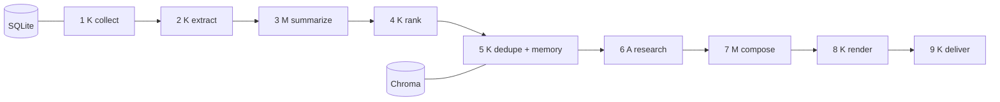

# <Project name>: <one sentence: what it does, for whom>

<One short paragraph: the problem and the result. Then a screenshot or a sample of the output.>

## How it works



K = plain code, M = one model call with a schema, A = a bounded agent. <One sentence on why only one stage is an agent.>
Details: [docs/architecture.md](docs/architecture.md).

## How I know it works

| category | passed | faithful (judge) | notes |
| --- | --- | --- | --- |
| <category> | 19/20 | 18/19 | <one line> |
| ... | | | |

Cost per issue: $<x> (<n> model calls, <tokens> tokens). Latest run report: [`out/run-report.json`](out/run-report.json).

## Run it

```powershell
uv sync
uv run python -m <package>.daily_job --out out --dry-run      # no key, fake model
uv run --env-file .env python -m <package>.daily_job --out out  # real run
```

Scheduled with GitHub Actions at 07:00 Asia/Jerusalem ([.github/workflows/daily.yml](.github/workflows/daily.yml)).

## Decisions and alternatives

See the ADR table in [docs/architecture.md](docs/architecture.md#decisions). Short version: <three bullets: what you did NOT build and why>.

## Known limitations

- <limitation 1, with a number>
- <limitation 2>
- <what is next>

## Repository layout

<five to eight lines>

## Setup

<key, .env, versions.json, first run. Last on purpose.>

## License

MIT
