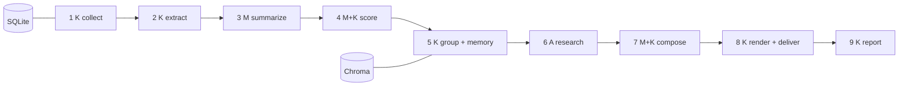

# <Project name>: <one sentence: what it does, for whom>

<One short paragraph: the problem and the result. Then a screenshot or a sample of the output.>

## How it works



K = plain code, M = one model call with a schema, A = a bounded agent. <One sentence on why only one stage is an agent.>
Details: [docs/architecture.md](docs/architecture.md).

## How I know it works

| part | cases | metric | latest value | threshold |
| --- | --- | --- | --- | --- |
| relevance | <n> labeled items | precision@8 | <x>/<n> | 0.75 |
| faithfulness | <n> labeled pairs | judge agreement with my labels (kappa) | <x>/<n> (<kappa>) | 0.80 |
| grouping | <n> pairs | precision / recall at the threshold | <a> / <b> | 0.90 / 0.75 |
| injection | <n> poisoned articles | pass rate | <x>/<n> | 1.0 |

Every value is the *latest* run, with its denominator, copied from `docs/eval-latest.md` with the date.
Cost per issue: $<x> from the latest run report (`data/runs/<date>/run-report.md`); target $0.10, hard stop $0.25.

## Run it

```powershell
uv sync
uv run <cli> run --offline                 # fixture feeds + fake models: no key, no network
uv run --env-file .env <cli> run           # the real thing
```

Scheduled with GitHub Actions at 07:00 Asia/Jerusalem ([.github/workflows/daily.yml](.github/workflows/daily.yml)).

## Decisions and alternatives

See the ADR table in [docs/architecture.md](docs/architecture.md#decisions). Short version: <three bullets: what you did NOT build and why>.

## Known limitations

- <limitation 1, with a number>
- <limitation 2>
- <what is next>

## Repository layout

<five to eight lines>

## Setup

<key, .env, versions.json, first run. Last on purpose.>

## License

MIT
