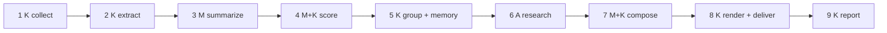

# Architecture

## The pipeline

**Where the model is used.** Stages 3, 4 (reasons only), 6 and 7. Everything else is plain code: <one sentence why>.

## Data model

| store | what | retention |
| --- | --- | --- |
| SQLite `articles` | fetched items, extracted text, status | 90 days |
| SQLite `runs`, `deliveries` | run reports, idempotent delivery records | 1 year |
| Chroma `story_memory` | embedding of title + lead, {day, cluster_id, url} | 60 days |
| files `out/` | issues, traces, reports | 14 days |

## Decisions

| decision | alternative | why | what would change my mind |
| --- | --- | --- | --- |
| plain workflow, one bounded agent stage | agent for the whole pipeline | the code knows the steps; only research depends on what is found | a stage whose next step depends on results |
| numpy for same-day dedupe, Chroma for cross-day memory | Chroma for both / SQLite blobs | the "is numpy enough" test: yes for a day, no for persistence + date filter | > 100k vectors or multi-process |
| no fine-tuning | fine-tune the summarizer | the failure was unsupported facts, not style; spec + schema fixed it (<before>/<n> -> <after>/<n>, from my eval) | a narrow task with thousands of labeled examples and a plateau |
| hand-written loop, LangGraph as an optional extension | LangGraph in the core | no branching, one interrupt, one author | three signs: real branching, interrupts in many places, several people |
| fast model for summaries and scores, smart for research and the intro | one model | eval held with the fast model; cost -<x>% (from two run reports) | eval drops after a provider update |
| ... | | | |

## Known limitations

- <one>
- <two>
- <three>
