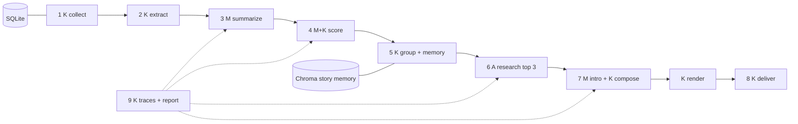

# Morning Brief: a scheduled, personalized morning newsletter agent

Every morning at 07:00, Morning Brief reads a few dozen articles from feeds you chose and delivers a short brief: the
stories that matter to *you*, each with a faithful three-bullet summary, one line on why it matters to you, links to the
originals, "also covered by" when several sources ran the story, and "follow-up" when you saw it before. The top three
stories get extra context from a small, bounded research agent. One issue costs cents, is never sent twice, survives
a dead feed or a provider outage, ignores instructions planted inside articles, and every link comes from a source.

> Reference implementation for the course capstone. Fill in your own numbers after your first real week.

## How it works

<div dir="ltr" align="left">



</div>

K = plain code, M = one model call with a schema, A = a bounded agent. Only the research stage is an agent: it decides
which items to read, within six steps and a budget; every other stage is a workflow because the code already knows the
next step. Details and the decision table: [docs/architecture.md](docs/architecture.md), [docs/decisions.md](docs/decisions.md).

## How I know it works

| metric | value | threshold |
| --- | --- | --- |
| relevance precision@8 | _fill from docs/eval-latest.md_ | 0.75 |
| summary faithfulness (judge vs my labels) | _fill_ | 0.80 |
| grouping precision / recall | _fill_ | 0.90 / 0.75 |
| injection pass rate | _fill_ | 1.0 |

Cost per issue: _fill from the run report_ (target $0.10, hard stop $0.25). Latest report: `data/runs/<date>/run-report.md`.

## Run it

<div dir="ltr" align="left">

```powershell
uv sync
uv run morning-brief run --offline                 # fixture feeds + fake models: no key, no network
uv run --env-file .env morning-brief run           # the real thing, file delivery
uv run --env-file .env morning-brief run --channels file,email
uv run morning-brief preview --date 2026-10-03
```

</div>

Scheduled with GitHub Actions at 07:00 Asia/Jerusalem ([.github/workflows/daily.yml](.github/workflows/daily.yml));
the local alternatives (Windows Task Scheduler, Mac/Linux cron) are in [docs/architecture.md](docs/architecture.md#running-it).

## Decisions and alternatives

Short version: no RAG over a corpus (there is no corpus to ask), Chroma only for cross-day memory (numpy for the day),
an agent only for research, LangGraph only as an optional approval-gate extension. The full table with "what would
change my mind" is in [docs/decisions.md](docs/decisions.md).

## Known limitations

- One reader, public feeds, ~40 articles a day. At 1,000 readers the summarize stage is shared and ranking is per reader.
- The faithfulness judge is a model; ten answers are re-checked by hand every week.
- Research uses only links found inside the day's items; web search is an optional extension.

## Repository layout

<div dir="ltr" align="left">

```text
src/morning_brief/   config, store, tracing, budget, pipeline, cli, sources/, extract, summarize, rank, embeddings,
                     cluster, memory, research, compose, render/, deliver/, security, offline, llm/{client,schemas,prompts}
evals/               cases/*.jsonl and run_eval.py (four parts, thresholds)
tests/               offline tests; `pytest --live -m live` for the paid tier
fixtures/            fixture feeds for offline runs
docs/                architecture, decisions, eval, security, demo
```

</div>

## Setup

1. `uv sync`, then copy `env.example` to `.env` and paste your key (the free tier is enough).
2. Edit `profile.yaml`: topics with weights, skip topics, your feeds. No name or email there.
3. `uv run morning-brief run --offline` to see an issue appear in `out/`; then the real run.
4. For email: Gmail SMTP with an app password in `.env`. For scheduling: add `GEMINI_API_KEY` as a repository secret.

## License

MIT
